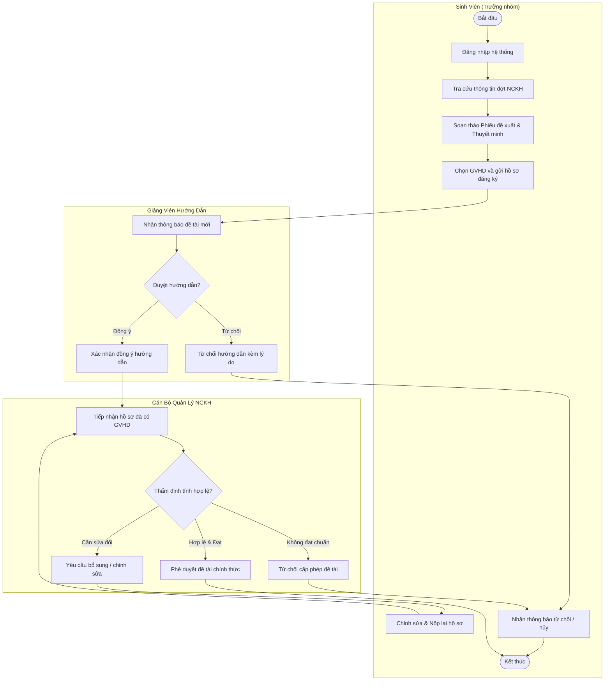
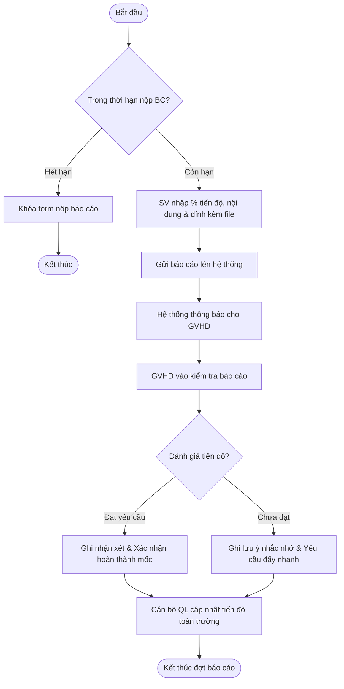
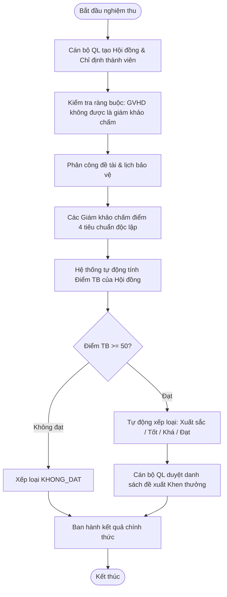
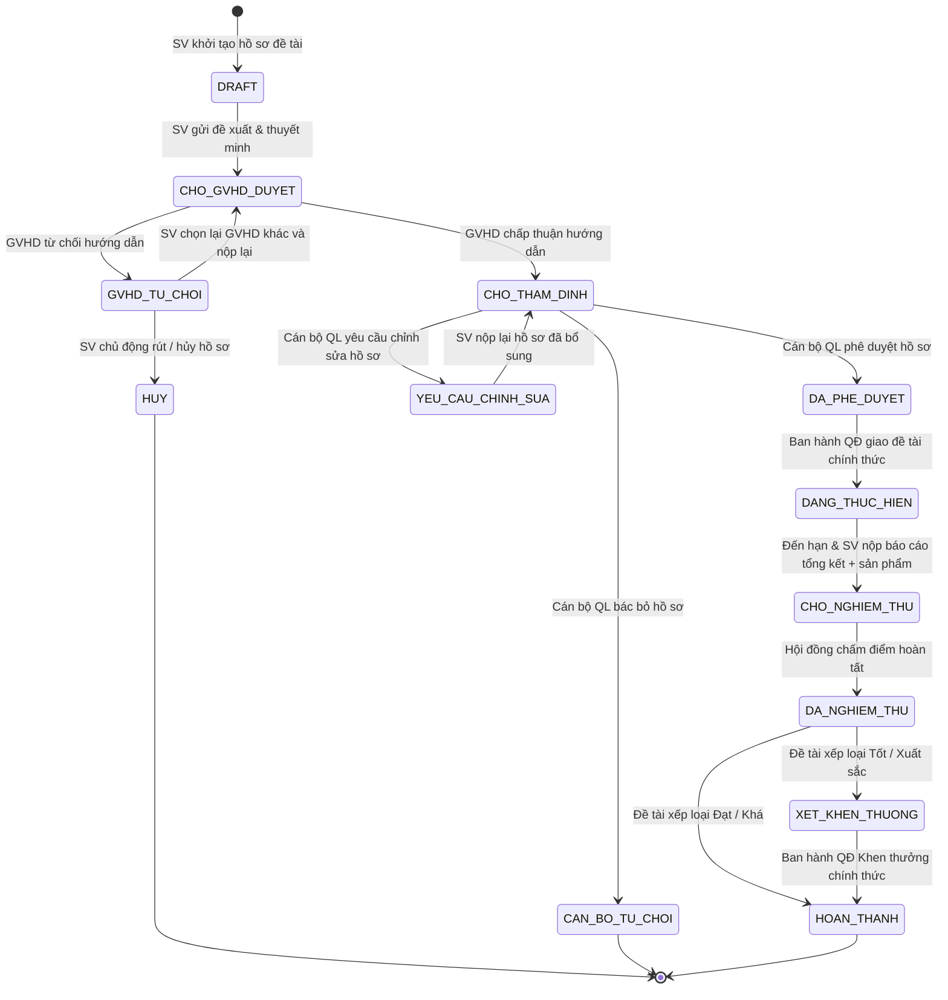
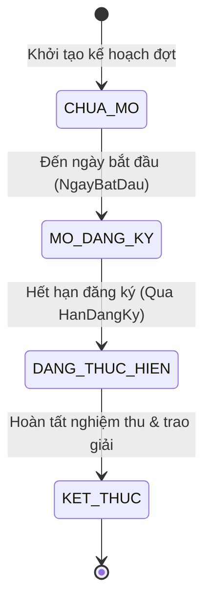

# TÀI LIỆU BÁO CÁO BÀI TẬP LỚN
## MÔN HỌC: PHÂN TÍCH VÀ THIẾT KẾ HỆ THỐNG THÔNG TIN (OOAD / UML)

---

* **Đề tài**: Hệ Thống Quản Lý Hoạt Động Nghiên Cứu Khoa Học Sinh Viên
* **Mã dự án**: `HTQL_NCKH_SV_TBU`
* **Đơn vị đào tạo**: Trường Đại học Tây Bắc ([https://utb.edu.vn/](https://utb.edu.vn/))
* **Khoa chủ quản**: Khoa Tự nhiên và Công nghệ ([https://nst.utb.edu.vn/gioi-thieu.html](https://nst.utb.edu.vn/gioi-thieu.html))
* **Đối tượng sử dụng**: Sinh viên (SV), Giảng viên hướng dẫn (GVHD), Cán bộ Quản lý NCKH (CBQL / Admin)

---

## MỤC LỤC TỔNG QUAN
1. [Khảo sát bài toán & Phạm vi hệ thống](#1-khảo-sát-bài-toán--phạm-vi-hệ-thống)
2. [Quy tắc nghiệp vụ quan trọng (Business Rules - Cần Note Kỹ)](#2-quy-tắc-nghiệp-vụ-quan-trọng-business-rules)
3. [Phân rã Use Case hệ thống (15 Use Case Cốt Lõi)](#3-phân-rã-use-case-hệ-thống-15-use-case)
4. [So sánh: Biểu đồ Hoạt động vs Biểu đồ Trạng thái](#4-so-sánh-chọn-lựa-biểu-đồ-hoạt-động-vs-biểu-đồ-trạng-thái)
5. [Thiết kế Biểu đồ Hoạt động (Activity Diagrams)](#5-thiết-kế-biểu-đồ-hoạt-động-activity-diagrams)
6. [Thiết kế Biểu đồ Trạng thái (State Diagrams)](#6-thiết-kế-biểu-đồ-trạng-thái-state-diagrams)
7. [Thiết kế Dữ liệu & Kiến trúc Hệ thống](#7-thiết-kế-dữ-liệu--kiến-trúc-hệ-thống)
8. [Các điểm nhấn quan trọng khi thuyết trình & bảo vệ BTL](#8-các-điểm-nhấn-khi-thuyết-trình--bảo-vệ-btl)

---

## 1. KHẢO SÁT BÀI TOÁN & PHẠM VI HỆ THỐNG

### 1.1. Hiện trạng & Lý do phát triển
* **Trước khi có hệ thống**: Sinh viên nộp hồ sơ giấy (Phiếu đề xuất, Thuyết minh, Báo cáo tiến độ) trực tiếp qua khoa/phòng, dễ thất lạc, khó tra cứu tiến độ, việc lập hội đồng nghiệm thu và tính điểm thủ công mất nhiều thời gian, dễ sai sót.
* **Mục tiêu hệ thống**: Tin học hóa 100% quy trình khép kín: từ lúc phát động đợt NCKH, sinh viên lập nhóm đăng ký, GVHD nhận xét duyệt, Cán bộ QL thẩm định, báo cáo tiến độ trực tuyến, thành lập hội đồng chấm điểm, tổng hợp kết quả đến ban hành quyết định khen thưởng.

### 1.2. Ba tác nhân (Actors) chính
1. **Sinh viên (`SinhVien`)**: Người thực hiện đề tài (Trưởng nhóm hoặc Thành viên), nộp hồ sơ, báo cáo và sản phẩm.
2. **Giảng viên hướng dẫn (`GiangVien`)**: Người định hướng chuyên môn, duyệt đề tài tham gia, theo dõi và nhận xét tiến độ.
3. **Cán bộ Quản lý NCKH (`CanBoQL`)**: Quản trị viên phòng QLKH hoặc Ban chủ nhiệm Khoa: ban hành đợt, thẩm định hồ sơ, thành lập Hội đồng chấm nghiệm thu, xếp loại và lập danh sách khen thưởng.

---

## 2. QUY TẮC NGHIỆP VỤ QUAN TRỌNG (BUSINESS RULES)
> [!IMPORTANT]
> **Những điểm bắt buộc phải ghi rõ trong báo cáo để ghi điểm tối đa:**

1. **Ràng buộc thời hạn đợt NCKH**:
   - Sinh viên chỉ được đăng ký đề tài khi đợt NCKH ở trạng thái `MO_DANG_KY` và trước thời điểm `HanDangKy`.
   - Sinh viên chỉ được nộp báo cáo tiến độ trước thời hạn `HanNopBaoCaoTD`.
   - Sinh viên chỉ được nộp tài liệu nghiệm thu & sản phẩm trước thời hạn `HanNopNghiemThu`.

2. **Ràng buộc thành viên & vai trò đề tài**:
   - Mỗi đề tài bắt buộc có **1 Trưởng nhóm** (`TRUONG_NHOM`) và tối đa các Thành viên (`THANH_VIEN`).
   - Chỉ có **Trưởng nhóm** mới có quyền nộp thuyết minh, chỉnh sửa hồ sơ đề tài, nộp báo cáo tiến độ và rút/hủy đề tài.

3. **Ràng buộc chống xung đột lợi ích (Conflict of Interest) trong Hội đồng**:
   - Giảng viên đang là **GVHD của đề tài** thì **TUYỆT ĐỐI KHÔNG** được phân công làm thành viên trong Hội đồng chấm đề tài đó.

4. **Ràng buộc tính điểm & xếp loại**:
   - Điểm tổng kết = Trung bình cộng điểm của các thành viên Hội đồng đã nhập phiếu chấm.
   - Thang điểm đánh giá: Tổng quan (tối đa 20đ), Phương pháp (tối đa 30đ), Sản phẩm (tối đa 30đ), Báo cáo (tối đa 20đ) $\rightarrow$ Tổng 100đ.
   - Xếp loại:
     - $\ge 85$: Xuất sắc (được đề xuất Giải Nhất/Nhì)
     - $70 - 84$: Tốt (Giải Ba/Khuyến khích)
     - $55 - 69$: Khá
     - $50 - 54$: Đạt
     - $< 50$: Không đạt

5. **Quy tắc xóa dữ liệu (Data Integrity)**:
   - Đợt NCKH đã có đề tài tham gia: **Không được xóa cứng** mà phải xử lý thu hồi/lưu trữ hoặc chỉ xóa khi chưa phát sinh liên kết đề tài.
   - Đề tài đã được giao thực hiện (`DANG_THUC_HIEN`, `DA_NGHIEM_THU`): Không thể tự do xóa bởi sinh viên để đảm bảo tính lưu vết học thuật.

---

## 3. PHÂN RÃ USE CASE HỆ THỐNG (15 USE CASE)

| STT | Phân hệ (Actor) | Mã Use Case | Tên Use Case | Mục đích / Mô tả ngắn |
| :---: | :--- | :--- | :--- | :--- |
| 1 | **Sinh viên** | `UC_SV_01` | Xem thông tin NCKH | Xem quy chế, đợt phát động, tải biểu mẫu mẫu |
| 2 | **Sinh viên** | `UC_SV_02` | Đăng ký đề tài | Điền phiếu đề xuất, thuyết minh, chọn GVHD và nộp |
| 3 | **Sinh viên** | `UC_SV_03` | Sửa hồ sơ đề tài | Bổ sung, sửa đổi thông tin khi GVHD/CBQL yêu cầu |
| 4 | **Sinh viên** | `UC_SV_04` | Nộp báo cáo tiến độ | Cập nhật % hoàn thành, khó khăn, minh chứng |
| 5 | **Sinh viên** | `UC_SV_05` | Báo cáo tổng kết | Nộp báo cáo nghiệm thu, liên kết sản phẩm nghiên cứu |
| 6 | **Sinh viên** | `UC_SV_06` | Xem kết quả | Tra cứu điểm số, nhận xét hội đồng, quyết định khen thưởng |
| 7 | **Giảng viên** | `UC_GV_01` | Tiếp nhận hồ sơ | Xem danh sách đề tài sinh viên đăng ký mời hướng dẫn |
| 8 | **Giảng viên** | `UC_GV_02` | Duyệt hướng dẫn | Xác nhận nhận hướng dẫn hoặc từ chối kèm lý do |
| 9 | **Giảng viên** | `UC_GV_03` | Theo dõi tiến độ | Xem báo cáo định kỳ của SV và ghi nhận xét chỉ đạo |
| 10 | **Giảng viên** | `UC_GV_04` | Đánh giá sơ bộ | Xác nhận đề tài đạt yêu cầu để chuyển sang nghiệm thu |
| 11 | **Cán bộ QL** | `UC_CB_01` | Quản lý đợt NCKH | Khởi tạo đợt, thiết lập thời hạn, đóng/mở đợt |
| 12 | **Cán bộ QL** | `UC_CB_02` | Thẩm định đề tài | Duyệt hồ sơ, phê duyệt chính thức giao đề tài |
| 13 | **Cán bộ QL** | `UC_CB_03` | Quản lý tiến độ | Giám sát tiến độ toàn trường, đôn đốc các nhóm chậm trễ |
| 14 | **Cán bộ QL** | `UC_CB_04` | Tổ chức nghiệm thu | Lập Hội đồng, phân công lịch bảo vệ, nhập điểm giám khảo |
| 15 | **Cán bộ QL** | `UC_CB_05` | Xếp loại & Khen thưởng | Tự động tính điểm TB, xếp loại học thuật, ban hành khen thưởng |

---

## 4. SO SÁNH: CHỌN LỰA BIỂU ĐỒ HOẠT ĐỘNG VS BIỂU ĐỒ TRẠNG THÁI
> [!TIP]
> **Điểm mấu chốt để trả lời thầy cô chấm vấn đáp bài tập lớn:**

| Tiêu chí | Biểu đồ Hoạt động (Activity Diagram) | Biểu đồ Trạng thái (State Diagram) |
| :--- | :--- | :--- |
| **Bản chất** | Mô hình hóa **luồng công việc (Workflow)** và quy trình nghiệp vụ từng bước. | Mô hình hóa **vòng đời (Lifecycle)** của một đối tượng dữ liệu cụ thể. |
| **Góc nhìn** | Tập trung vào: *"Hành động gì xảy ra tiếp theo? Ai làm? Điều kiện rẽ nhánh là gì?"* | Tập trung vào: *"Đối tượng đang ở trạng thái nào? Sự kiện (Event) nào kích hoạt chuyển trạng thái?"* |
| **Thành phần chính** | Action Node, Decision Node (rẽ nhánh), Fork/Join (song song), Swimlanes (phân làn Actor). | States (Trạng thái), Transitions (Chuyển trạng thái), Triggers/Events, Guards (Điều kiện canh). |
| **Trường hợp áp dụng tốt nhất trong bài** | **Áp dụng cho các quy trình liên tác nhiều bên**:  1. Quy trình Đăng ký & Xét duyệt đề tài (3 làn: SV - GVHD - CBQL) 2. Quy trình Báo cáo tiến độ & Nhận xét 3. Quy trình Tổ chức hội đồng nghiệm thu & Nhập điểm | **Áp dụng cho các đối tượng có vòng đời phức tạp**:  1. Vòng đời Đề tài NCKH (`DeTai`) 2. Vòng đời Đợt NCKH (`DotNCKH`) 3. Vòng đời Báo cáo tiến độ (`BaoCaoTienDo`) |

---

## 5. THIẾT KẾ BIỂU ĐỒ HOẠT ĐỘNG (ACTIVITY DIAGRAMS)

### 5.1. Biểu đồ 1: Quy trình Đăng ký & Xét duyệt đề tài NCKH (Swimlane 3 Actor)
* **Đối tượng tham gia**: Sinh viên, GVHD, Cán bộ QL.
* **Đặc điểm**: Có phân làn (Partition), có rẽ nhánh điều kiện (Decision).

---

### 5.2. Biểu đồ 2: Quy trình Báo cáo Tiến độ định kỳ
* **Đặc điểm**: Luồng kiểm tra hạn nộp, nộp sản phẩm trung gian và phản hồi của GVHD.

---

### 5.3. Biểu đồ 3: Quy trình Nghiệm thu, Chấm điểm & Xếp loại
* **Đặc điểm**: Phối hợp giữa Cán bộ QL, Hội đồng phản biện và hệ thống tính điểm tự động.

---

## 6. THIẾT KẾ BIỂU ĐỒ TRẠNG THÁI (STATE DIAGRAMS)

### 6.1. Biểu đồ Trạng thái Đề tài NCKH (`DeTai`) - QUAN TRỌNG NHẤT
> [!IMPORTANT]
> Đây là biểu đồ trạng thái điển hình và giá trị nhất trong đề tài này. Một đề tài trải qua chuỗi biến đổi trạng thái dựa trên các hành động xét duyệt của các Actor.

#### Bảng ma trận chuyển trạng thái của `DeTai`:
| Trạng thái hiện tại | Sự kiện kích hoạt (Trigger) | Điều kiện canh (Guard) | Trạng thái tiếp theo |
| :--- | :--- | :--- | :--- |
| `DRAFT` | `guiDangKy()` | Hồ sơ đủ TM & ĐX, trong hạn | `CHO_GVHD_DUYET` |
| `CHO_GVHD_DUYET` | `gvDuyet(dong_y)` | GV đồng ý | `CHO_THAM_DINH` |
| `CHO_GVHD_DUYET` | `gvDuyet(tu_choi)` | Có lý do từ chối | `GVHD_TU_CHOI` |
| `CHO_THAM_DINH` | `cbThamDinh(yeu_cau_sua)` | Cần bổ sung minh chứng | `YEU_CAU_CHINH_SUA` |
| `CHO_THAM_DINH` | `cbThamDinh(phe_duyet)` | Hồ sơ hợp lệ | `DA_PHE_DUYET` |
| `DA_PHE_DUYET` | `giaoDeTaiChinhThuc()` | Có Quyết định giao | `DANG_THUC_HIEN` |
| `DANG_THUC_HIEN` | `nopBaoCaoNghiemThu()` | Nộp đủ báo cáo & sản phẩm | `CHO_NGHIEM_THU` |
| `CHO_NGHIEM_THU` | `tongKetDiemHoiDong()` | Đủ số phiếu giám khảo | `DA_NGHIEM_THU` |
| `DA_NGHIEM_THU` | `xepLoaiKhenThuong()` | Điểm TB $\ge 70$ | `XET_KHEN_THUONG` |
| `XET_KHEN_THUONG` | `banHanhKhenThuong()` | Có số Quyết định | `HOAN_THANH` |

---

### 6.2. Biểu đồ Trạng thái Đợt NCKH (`DotNCKH`)
* **Đặc điểm**: Trạng thái phụ thuộc vào các mốc thời gian thực tế trong năm học.

---

## 7. THIẾT KẾ DỮ LIỆU & KIẾN TRÚC HỆ THỐNG

### 7.1. Mô hình Dữ liệu Quan hệ (ERD - 18 Bảng)
* **Bảng người dùng & phân quyền**: `NguoiDung`, `SinhVien`, `GiangVien`, `CanBoQL`.
* **Bảng danh mục & đợt**: `DotNCKH`, `HuongNghienCuu`, `ThongBaoBieuMau`.
* **Bảng đề tài & thành viên**: `DeTai`, `ThanhVienDeTai`, `LichSuChinhSua`.
* **Bảng tiến độ & báo cáo**: `BaoCaoTienDo`, `BaoCaoTongKet`, `SanPhamNghienCuu`.
* **Bảng hội đồng & đánh giá**: `HoiDong`, `ThanhVienHoiDong`, `PhanCongHoiDong`, `PhieuDanhGia`, `KetQuaKhenThuong`.

### 7.2. Giải pháp Ràng buộc Khóa Ngoại & Toàn Vẹn Dữ Liệu
Khi trình bày bài tập lớn, cần nêu rõ chiến lược xử lý khóa ngoại:
* **`CASCADE`**: Khi xóa đề tài nháp $\rightarrow$ tự động xóa sạch các bản ghi phụ thuộc (`ThanhVienDeTai`, `LichSuChinhSua`, `BaoCaoTienDo`).
* **`RESTRICT`**: Không cho phép xóa Đợt NCKH nếu đã có Đề tài liên kết hoặc Hội đồng đang phân công để chống mồ côi dữ liệu (Data Inconsistency).

---

## 8. CÁC ĐIỂM NHẤN KHI THUYẾT TRÌNH & BẢO VỆ BTL

1. **Khẳng định tính thực tế**:
   - Hệ thống được thiết kế bám sát thực tế của **Trường Đại học Tây Bắc** và **Khoa Tự nhiên và Công nghệ**, có tích hợp cổng thông tin và quy chuẩn biểu mẫu NCKH sinh viên.
2. **Khẳng định tính chặt chẽ trong phân tích thiết kế**:
   - Tách biệt rõ ràng **15 Use Case** không bị chồng chéo quyền hạn.
   - Sử dụng **Biểu đồ Hoạt động** để mô tả luồng phối hợp 3 bên giữa SV, GVHD và CBQL.
   - Sử dụng **Biểu đồ Trạng thái** để theo dõi chặt chẽ vòng đời đề tài từ khi nộp đến nghiệm thu.
3. **Giá trị kỹ thuật nổi bật**:
   - Kiến trúc MVC chuẩn, mã nguồn sạch, xử lý điều hướng tập trung qua Front Controller.
   - Cơ chế bảo mật: Mã hóa mật khẩu chuẩn Bcrypt, kiểm soát vai trò qua Middleware Session, chống trùng lặp dữ liệu.
