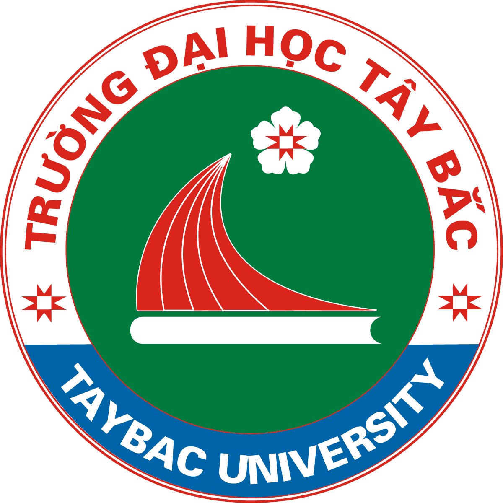
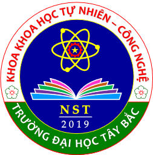
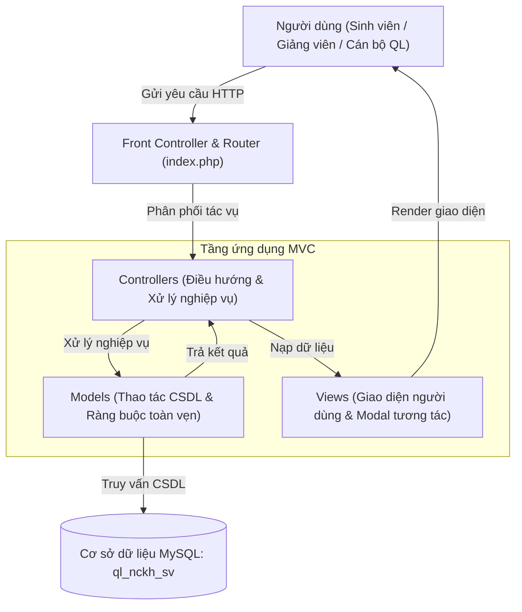
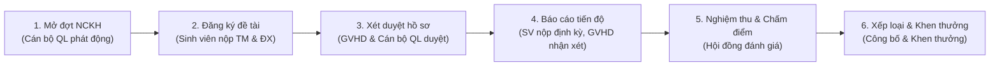

  
  &nbsp;&nbsp;&nbsp;&nbsp;&nbsp;&nbsp;&nbsp;&nbsp;
  

<h1 align="center">Hệ Thống Quản Lý Nghiên Cứu Khoa Học Sinh Viên Trường Đại Học Tây Bắc (UTB)</h1>

  <b>Đơn vị đào tạo & nghiên cứu:</b> <a href="https://utb.edu.vn/" target="_blank">Trường Đại học Tây Bắc</a> | <a href="https://nst.utb.edu.vn/gioi-thieu.html" target="_blank">Khoa Tự nhiên và Công nghệ</a>

---

## 📌 Bài toán đặt ra

**1. Mô tả quy trình hệ thống**

Mô hình hệ thống Quản lý Hoạt động Nghiên cứu Khoa học (NCKH) Sinh viên gồm các đối tượng chính là Sinh viên, Giảng viên hướng dẫn (GVHD) và Cán bộ Quản lý NCKH . Khi nhà trường mở đợt đăng ký, sinh viên có nhu cầu tham gia NCKH sẽ đăng nhập vào hệ thống để tìm hiểu thông tin về các đợt phát động, quy định, biểu mẫu và danh sách các hướng nghiên cứu. Sinh viên lập nhóm, điền thông tin đề tài gồm Phiếu thuyết minh và Phiếu đề xuất và chọn GVHD rồi gửi yêu cầu đăng ký lên hệ thống.

GVHD tiếp nhận yêu cầu, xem xét đề tài và tiến hành xét duyệt (đồng ý hoặc từ chối hướng dẫn). Nếu được GVHD chấp thuận, hồ sơ sẽ được chuyển tiếp đến Cán bộ Quản lý NCKH  để thẩm định và trình Hội đồng xét duyệt cấp trường/khoa. Cán bộ quản lý kiểm tra tính hợp lệ, cập nhật trạng thái đề tài (Được duyệt hoặc Yêu cầu sửa đổi). Sau khi đề tài được giao, định kỳ sinh viên nộp báo cáo tiến độ hoàn thành cho hội đồng được thành lập bởi Cán bộ Quản lý NCKH. Đến hạn nghiệm thu, sinh viên nộp báo cáo tổng kết và sản phẩm nghiên cứu. Cán bộ Quản lý NCKH tổ chức hội đồng đánh giá,  nghiệm thu, xếp loại kết quả và tiến hành lập danh sách khen thưởng cho các đề tài đạt thành tích tốt.

**2. Phân loại vai trò và các Use Case**

| Vai trò | Actor: Sinh viên | Actor: Giảng viên hướng dẫn | Actor: Cán bộ Quản lý NCKH |
| :---- | :---- | :---- | :---- |
| **Các Use Case** | 1. Đăng nhập hệ thống. 2. Xem thông tin các đợt NCKH và biểu mẫu hướng dẫn. 3. Đăng ký đề tài NCKH. 4. Chỉnh sửa hồ sơ đăng ký theo góp ý. 5. Nộp báo cáo tiến độ định kỳ. 6. Nộp báo cáo tổng kết và sản phẩm nghiên cứu. 7. Tra cứu kết quả đánh giá, xếp loại đề tài. | 1. Đăng nhập hệ thống. 2. Xem và tiếp nhận hồ sơ đề tài. 3. Xét duyệt/Xác nhận hướng dẫn đề tài. 4. Theo dõi và ghi nhận xét tiến độ thực hiện đề tài. 5. Đánh giá sơ bộ sản phẩm và xác nhận cho phép sinh viên nghiệm thu. | 1. Đăng nhập hệ thống. 2. Đăng tải thông báo, quy định đợt NCKH mới. 3. Thẩm định và duyệt đề tài. 4. Quản lý tiến độ thực hiện các đề tài. 5. Tổ chức hội đồng nghiệm thu + Nhập kết quả đánh giá. 6. Tổng hợp điểm, xếp loại kết quả đề tài. 7. Xuất danh sách khen thưởng và in báo cáo thống kê. |

**Trong đó hệ thống tập trung vào 15 Use Case cốt lõi:**

### **Sinh viên**
1. **Xem thông tin NCKH**  
2. **Đăng ký đề tài**  
3. **Sửa hồ sơ đề tài**  
4. **Nộp báo cáo tiến độ**  
5. **Báo cáo tổng kết**  
6. **Xem kết quả**

### **Giảng viên hướng dẫn**
1. **Tiếp nhận hồ sơ**  
2. **Duyệt hướng dẫn**  
3. **Theo dõi tiến độ**  
4. **Đánh giá sơ bộ**

### **Cán bộ quản lý NCKH**
1. **Quản lý đợt NCKH**  
2. **Thẩm định đề tài**  
3. **Quản lý tiến độ**  
4. **Tổ chức nghiệm thu**  
5. **Xếp loại và khen thưởng**

---

## 🏗️ Cấu trúc hệ thống & Luồng hoạt động trực quan

### 1. Kiến trúc phân tầng (Mô hình MVC chuẩn)

### 2. Sơ đồ chu trình hoạt động trực quan (6 giai đoạn khép kín)

* **Sinh viên** chủ động xuyên suốt từ bước **2 → 4 → 5**.
* **Giảng viên hướng dẫn** đồng hành phê duyệt và giám sát ở bước **3 → 4 → 5**.
* **Cán bộ Quản lý NCKH** điều phối toàn bộ từ bước **1 → 3 → 5 → 6**.

---

## 🚀 Hướng dẫn cài đặt & chạy thử

### 1. Yêu cầu môi trường
- Đã cài đặt [XAMPP](https://www.apachefriends.org/) (hỗ trợ PHP 8.x và MySQL / MariaDB).
- Đặt thư mục mã nguồn vào: `C:\xampp\htdocs\web1` (hoặc thư mục tương ứng trong `htdocs`).

### 2. Khởi tạo Cơ sở dữ liệu
Bật **Apache** và **MySQL** trong XAMPP Control Panel, sau đó chọn **1 trong 3 cách** sau:
- **Cách 1 (Nhanh nhất - Khuyên dùng)**: Nhấp đúp chạy file `setup_database.bat` trong thư mục dự án để tự động tạo CSDL `ql_nckh_sv` và nạp dữ liệu mẫu.
- **Cách 2 (Qua giao diện Web)**: Mở trình duyệt truy cập `http://localhost/web1/setup.php` và nhấn nút thực thi khởi tạo.
- **Cách 3 (Thủ công qua phpMyAdmin)**: Vào `http://localhost/phpmyadmin/`, tạo database `ql_nckh_sv`, rồi import lần lượt 2 file:
  1. `database/schema.sql` (Cấu trúc 18 bảng)
  2. `database/sample_data.sql` (Dữ liệu mẫu thử nghiệm)

### 3. Đăng nhập & Trải nghiệm
Mở trình duyệt truy cập: **`http://localhost/web1/`**

**Tài khoản thử nghiệm (Mật khẩu chung: `123456`)**:

| Vai trò | Tên đăng nhập | Họ và tên | Chức năng chính |
| :--- | :--- | :--- | :--- |
| **Cán bộ QL** | `ADMIN` / `CB001` | Quản trị viên / Trưởng phòng QLKH | Quản lý đợt NCKH, thẩm định đề tài, hội đồng & khen thưởng |
| **Giảng viên** | `GV001` | TS. Lê Hoàng Nam | Duyệt hướng dẫn đề tài, theo dõi & nhận xét tiến độ |
| **Giảng viên** | `GV002` | ThS. Trần Thị Mai | Giảng viên hướng dẫn, chấm điểm hội đồng |
| **Sinh viên** | `SV001` | Nguyễn Huy Hoàng | Trưởng nhóm đề tài đã nghiệm thu, xem kết quả khen thưởng |
| **Sinh viên** | `SV002` | Trần Mai Anh | Đăng ký đề tài mới, nộp báo cáo tiến độ định kỳ |
