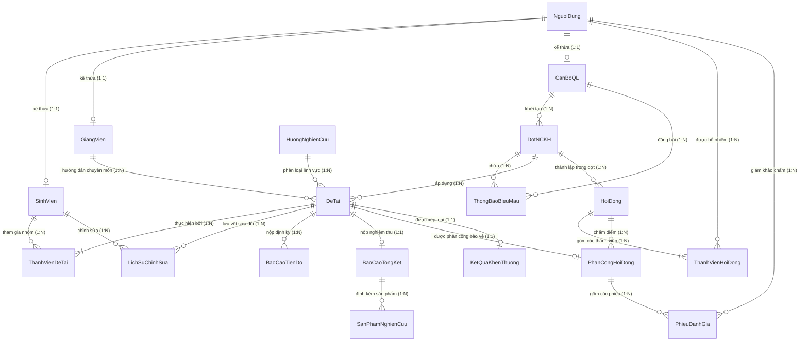

# 2.3.5. THIẾT KẾ CƠ SỞ DỮ LIỆU CỦA HỆ THỐNG (DATABASE DESIGN)

---

## 1. TỔNG QUAN HỆ CƠ SỞ DỮ LIỆU

* **Tên cơ sở dữ liệu:** `ql_nckh_sv`
* **Hệ quản trị CSDL (DBMS):** MySQL 8.x / MariaDB 10.3+
* **Storage Engine:** `InnoDB` (hỗ trợ Transaction ACID và Ràng buộc Khóa ngoại toàn vẹn)
* **Bảng mã / Collation:** `utf8mb4` / `utf8mb4_unicode_ci` (hỗ trợ đầy đủ tiếng Việt có dấu và ký tự đặc biệt)
* **Mức độ chuẩn hóa:** Chuẩn hóa bậc 3 (**3NF - Third Normal Form**), triệt tiêu hoàn toàn dư thừa dữ liệu và dị thường khi Thêm / Sửa / Xóa.
* **Quy mô:** Hệ thống gồm **18 bảng quan hệ**, được phân chia thành 5 phân hệ logic rõ ràng:
  1. **Phân hệ Người dùng & Phân quyền (4 bảng):** `NguoiDung`, `SinhVien`, `GiangVien`, `CanBoQL`.
  2. **Phân hệ Đợt NCKH & Biểu mẫu (3 bảng):** `DotNCKH`, `HuongNghienCuu`, `ThongBaoBieuMau`.
  3. **Phân hệ Hồ sơ Đề tài & Nhóm nghiên cứu (3 bảng):** `DeTai`, `ThanhVienDeTai`, `LichSuChinhSua`.
  4. **Phân hệ Tiến độ & Báo cáo Sản phẩm (3 bảng):** `BaoCaoTienDo`, `BaoCaoTongKet`, `SanPhamNghienCuu`.
  5. **Phân hệ Hội đồng, Đánh giá & Khen thưởng (5 bảng):** `HoiDong`, `ThanhVienHoiDong`, `PhanCongHoiDong`, `PhieuDanhGia`, `KetQuaKhenThuong`.

---

## 2. SƠ ĐỒ THỰC THỂ LIÊN KẾT (ERD - ENTITY RELATIONSHIP DIAGRAM)

---

## 3. TỪ ĐIỂN DỮ LIỆU CHI TIẾT 18 BẢNG (DATA DICTIONARY)

### PHÂN HỆ 1: NGƯỜI DÙNG & PHÂN QUYỀN

#### Bảng 1: `NguoiDung` (Tài khoản người dùng chung)
* **Ý nghĩa:** Bảng trung tâm lưu trữ danh tính đăng nhập và thông tin liên lạc dùng chung cho tất cả các chủ thể tham gia hệ thống (Single Identity / Base User).
* **Khóa chính:** `MaNguoiDung`

| Tên Cột | Kiểu Dữ Liệu | Ràng Buộc (Constraints) | Ý Nghĩa Nghiệp Vụ |
| :--- | :--- | :--- | :--- |
| `MaNguoiDung` | VARCHAR(20) | **PRIMARY KEY** | Tên đăng nhập / Mã định danh (VD: SV001, GV001, CB001, ADMIN) |
| `MatKhauHash` | VARCHAR(255) | NOT NULL | Mật khẩu tài khoản đã băm bằng thuật toán an toàn (BCrypt) |
| `HoTen` | VARCHAR(100) | NOT NULL | Họ và tên đầy đủ của người dùng |
| `Email` | VARCHAR(100) | NOT NULL, **UNIQUE** | Địa chỉ email liên lạc chính thức (không được trùng lặp) |
| `SoDienThoai` | VARCHAR(15) | NULL | Số điện thoại liên lạc của người dùng |
| `VaiTro` | VARCHAR(20) | NOT NULL, CHECK | Vai trò chính: `SINH_VIEN`, `GIANG_VIEN`, `CAN_BO_QL`, `ADMIN` |
| `TrangThai` | VARCHAR(20) | NOT NULL, DEFAULT `'HOAT_DONG'` | Trạng thái tài khoản: `HOAT_DONG` (hoạt động), `KHOA` (bị khóa) |
| `NgayTao` | TIMESTAMP | DEFAULT CURRENT_TIMESTAMP | Thời điểm tài khoản được khởi tạo trên hệ thống |

---

#### Bảng 2: `SinhVien` (Thông tin chi tiết Sinh viên)
* **Ý nghĩa:** Chuyên biệt hóa bảng `NguoiDung` cho đối tượng sinh viên nghiên cứu khoa học.
* **Khóa chính:** `MaSV` (đồng thời là Khóa ngoại tham chiếu đến `NguoiDung.MaNguoiDung`)

| Tên Cột | Kiểu Dữ Liệu | Ràng Buộc (Constraints) | Ý Nghĩa Nghiệp Vụ |
| :--- | :--- | :--- | :--- |
| `MaSV` | VARCHAR(20) | **PRIMARY KEY**, **FK** | Mã số sinh viên (liên kết `NguoiDung(MaNguoiDung)`) |
| `Lop` | VARCHAR(50) | NOT NULL | Lớp sinh hoạt hành chính (VD: K64 ĐH CNTT B) |
| `Khoa` | VARCHAR(100) | NOT NULL | Khoa chuyên môn quản lý (VD: Khoa Tự nhiên và Công nghệ) |
| `NganhHoc` | VARCHAR(100) | NOT NULL | Tên ngành đào tạo chính quy (VD: Công nghệ thông tin) |
| `KhoaHoc` | VARCHAR(20) | NOT NULL | Khóa học theo niên giám đào tạo (VD: Khóa 64) |

---

#### Bảng 3: `GiangVien` (Thông tin chi tiết Giảng viên)
* **Ý nghĩa:** Chuyên biệt hóa bảng `NguoiDung` cho đối tượng giảng viên hướng dẫn hoặc giám khảo hội đồng.
* **Khóa chính:** `MaGV` (đồng thời là Khóa ngoại tham chiếu đến `NguoiDung.MaNguoiDung`)

| Tên Cột | Kiểu Dữ Liệu | Ràng Buộc (Constraints) | Ý Nghĩa Nghiệp Vụ |
| :--- | :--- | :--- | :--- |
| `MaGV` | VARCHAR(20) | **PRIMARY KEY**, **FK** | Mã cán bộ giảng viên (liên kết `NguoiDung(MaNguoiDung)`) |
| `HocHam` | VARCHAR(30) | NULL | Học hàm nhà nước phong tặng (VD: Giáo sư, Phó Giáo sư) |
| `HocVi` | VARCHAR(30) | NOT NULL | Học vị cao nhất (VD: Tiến sĩ, Thạc sĩ, Cử nhân, Kỹ sư) |
| `DonViCongTac` | VARCHAR(100) | NOT NULL | Bộ môn / Khoa công tác (VD: Bộ môn CNTT - Khoa TN&CN) |
| `LinhVucNghienCuu` | TEXT | NULL | Các hướng nghiên cứu chuyên sâu để sinh viên chọn hướng dẫn |

---

#### Bảng 4: `CanBoQL` (Thông tin Cán bộ Quản lý NCKH)
* **Ý nghĩa:** Chuyên biệt hóa bảng `NguoiDung` cho cán bộ thuộc Phòng Quản lý Khoa học hoặc Ban chủ nhiệm Khoa.
* **Khóa chính:** `MaCB` (đồng thời là Khóa ngoại tham chiếu đến `NguoiDung.MaNguoiDung`)

| Tên Cột | Kiểu Dữ Liệu | Ràng Buộc (Constraints) | Ý Nghĩa Nghiệp Vụ |
| :--- | :--- | :--- | :--- |
| `MaCB` | VARCHAR(20) | **PRIMARY KEY**, **FK** | Mã cán bộ quản lý (liên kết `NguoiDung(MaNguoiDung)`) |
| `PhongBan` | VARCHAR(100) | NOT NULL | Phòng ban chức năng (VD: Phòng Quản lý Khoa học & Hợp tác Quốc tế) |
| `ChucVu` | VARCHAR(50) | NOT NULL | Chức vụ công tác (VD: Trưởng phòng, Chuyên viên quản lý NCKH) |

---

### PHÂN HỆ 2: ĐỢT NCKH, HƯỚNG NGHIÊN CỨU & THÔNG BÁO

#### Bảng 5: `DotNCKH` (Đợt nghiên cứu khoa học sinh viên)
* **Ý nghĩa:** Quản lý các đợt phát động NCKH theo từng năm học kèm các mốc thời gian hạn định tự động khóa chức năng.
* **Khóa chính:** `MaDot`

| Tên Cột | Kiểu Dữ Liệu | Ràng Buộc (Constraints) | Ý Nghĩa Nghiệp Vụ |
| :--- | :--- | :--- | :--- |
| `MaDot` | VARCHAR(30) | **PRIMARY KEY** | Mã đợt NCKH (VD: `DOT-2026-K64`) |
| `TenDot` | VARCHAR(255) | NOT NULL | Tên gọi đầy đủ của đợt phát động NCKH |
| `NamHoc` | VARCHAR(20) | NOT NULL | Năm học diễn ra hoạt động (VD: 2025-2026) |
| `NgayBatDau` | DATE | NOT NULL | Ngày chính thức mở đợt NCKH |
| `HanDangKy` | DATE | NOT NULL | Thời hạn cuối cùng sinh viên được nộp hồ sơ đăng ký đề tài |
| `HanNopBaoCaoTD` | DATE | NOT NULL | Thời hạn chót sinh viên phải nộp báo cáo tiến độ định kỳ |
| `HanNopNghiemThu` | DATE | NOT NULL | Thời hạn chót sinh viên phải nộp báo cáo tổng kết & sản phẩm |
| `NgayKetThuc` | DATE | NOT NULL | Ngày tổng kết bế mạc đợt NCKH |
| `TrangThai` | VARCHAR(30) | NOT NULL, DEFAULT `'MO_DANG_KY'` | `MO_DANG_KY`, `DANG_THUC_HIEN`, `NGHIEM_THU`, `KET_THUC` |
| `MaCanBoTao` | VARCHAR(20) | NULL, **FK** | Mã cán bộ khởi tạo đợt (liên kết `CanBoQL(MaCB)`) |

---

#### Bảng 6: `HuongNghienCuu` (Danh mục hướng nghiên cứu)
* **Ý nghĩa:** Lưu trữ các hướng nghiên cứu chuyên ngành được Khoa / Trường định hướng và phê duyệt.
* **Khóa chính:** `MaHuongNC`

| Tên Cột | Kiểu Dữ Liệu | Ràng Buộc (Constraints) | Ý Nghĩa Nghiệp Vụ |
| :--- | :--- | :--- | :--- |
| `MaHuongNC` | VARCHAR(30) | **PRIMARY KEY** | Mã danh mục hướng nghiên cứu (VD: `HNC_AI`, `HNC_IOT`, `HNC_WEB`) |
| `TenHuongNC` | VARCHAR(255) | NOT NULL | Tên gọi chuyên ngành của hướng nghiên cứu |
| `MoTa` | TEXT | NULL | Tóm tắt phạm vi và định hướng sản phẩm của hướng NC |

---

#### Bảng 7: `ThongBaoBieuMau` (Thông báo, quy chế & biểu mẫu)
* **Ý nghĩa:** Kênh công bố thông tin chỉ đạo, hướng dẫn thể thức và biểu mẫu (Phiếu đề xuất, Thuyết minh) cho sinh viên.
* **Khóa chính:** `MaThongBao`

| Tên Cột | Kiểu Dữ Liệu | Ràng Buộc (Constraints) | Ý Nghĩa Nghiệp Vụ |
| :--- | :--- | :--- | :--- |
| `MaThongBao` | INT | **PRIMARY KEY**, AUTO_INCREMENT | Mã định danh bài thông báo / tài liệu tải lên |
| `MaDot` | VARCHAR(30) | NULL, **FK** | Liên kết với đợt NCKH tương ứng (nếu có) |
| `TieuDe` | VARCHAR(255) | NOT NULL | Tiêu đề ngắn gọn của thông báo hoặc tên biểu mẫu |
| `Loai` | VARCHAR(30) | NOT NULL, CHECK | Phân loại: `THONG_BAO`, `BIEU_MAU`, `QUY_DINH` |
| `NoiDung` | TEXT | NULL | Nội dung chi tiết thông báo hiển thị cho sinh viên |
| `FileDinhKem` | VARCHAR(500) | NULL | Đường dẫn file đính kèm trên server (DOCX, PDF, RAR...) |
| `NgayDang` | TIMESTAMP | DEFAULT CURRENT_TIMESTAMP | Thời điểm bài đăng được công bố |
| `NguoiDang` | VARCHAR(20) | NULL, **FK** | Cán bộ quản lý thực hiện đăng bài (liên kết `CanBoQL(MaCB)`) |

---

### PHÂN HỆ 3: HỒ SƠ ĐỀ TÀI & NHÓM THỰC HIỆN

#### Bảng 8: `DeTai` (Hồ sơ đề tài nghiên cứu khoa học)
* **Ý nghĩa:** Bảng trung tâm quản lý toàn bộ vòng đời, thông tin hồ sơ và quá trình xét duyệt của một đề tài NCKH.
* **Khóa chính:** `MaDeTai`

| Tên Cột | Kiểu Dữ Liệu | Ràng Buộc (Constraints) | Ý Nghĩa Nghiệp Vụ |
| :--- | :--- | :--- | :--- |
| `MaDeTai` | VARCHAR(30) | **PRIMARY KEY** | Mã đề tài (VD: `DT-2026-001`, `DT-2026-002`) |
| `TenDeTai` | VARCHAR(500) | NOT NULL | Tên đầy đủ của đề tài nghiên cứu |
| `MaDot` | VARCHAR(30) | NOT NULL, **FK** | Thuộc đợt NCKH nào (liên kết `DotNCKH(MaDot)`) |
| `MaHuongNC` | VARCHAR(30) | NOT NULL, **FK** | Thuộc hướng nghiên cứu nào (liên kết `HuongNghienCuu(MaHuongNC)`) |
| `MaGVHD` | VARCHAR(20) | NOT NULL, **FK** | Giảng viên hướng dẫn đề tài (liên kết `GiangVien(MaGV)`) |
| `MucTieu` | TEXT | NOT NULL | Mục tiêu nghiên cứu tổng quan và cụ thể |
| `NoiDungNC` | TEXT | NOT NULL | Tóm tắt nội dung và phương pháp triển khai nghiên cứu |
| `SanPhamDuKien` | TEXT | NOT NULL | Các kết quả, sản phẩm dự kiến bàn giao khi nghiệm thu |
| `KinhPhiDuKien` | DECIMAL(15,2) | NOT NULL, DEFAULT 0.00 | Dự toán kinh phí thực hiện đề tài (VNĐ) |
| `FilePhieuThuyetMinh` | VARCHAR(500) | NULL | File bản mềm thuyết minh đính kèm (DOCX / PDF) |
| `FilePhieuDeXuat` | VARCHAR(500) | NULL | File bản mềm phiếu đề xuất đính kèm (DOCX / PDF) |
| `DuLieuDeXuat` | LONGTEXT | NULL | Dữ liệu cấu trúc JSON lưu trữ toàn bộ các mục Phiếu Đề Xuất |
| `DuLieuThuyetMinh` | LONGTEXT | NULL | Dữ liệu cấu trúc JSON lưu trữ chi tiết Phiếu Thuyết Minh |
| `TrangThai` | VARCHAR(40) | NOT NULL, CHECK | Trạng thái đề tài trong vòng đời:  • `CHO_GVHD_DUYET` • `GVHD_TU_CHOI` • `CHO_THAM_DINH` • `YEU_CAU_CHINH_SUA` • `DA_PHE_DUYET` • `DANG_THUC_HIEN` • `CHO_NGHIEM_THU` • `DA_NGHIEM_THU` • `HUY` |
| `NhanXetGVHD` | TEXT | NULL | Lời nhận xét, góp ý của GVHD khi duyệt hồ sơ |
| `NgayGVHDDuyet` | TIMESTAMP | NULL | Thời điểm GVHD xác nhận duyệt hoặc từ chối |
| `NhanXetCanBo` | TEXT | NULL | Nhận xét thẩm định của Cán bộ Quản lý NCKH |
| `NgayCanBoDuyet` | TIMESTAMP | NULL | Thời điểm Cán bộ QL phê duyệt chính thức giao đề tài |
| `NgayDangKy` | TIMESTAMP | DEFAULT CURRENT_TIMESTAMP | Thời điểm nộp hồ sơ đề tài lên hệ thống |

---

#### Bảng 9: `ThanhVienDeTai` (Nhóm sinh viên thực hiện đề tài)
* **Ý nghĩa:** Quản lý mối quan hệ Nhiều - Nhiều ($N:M$) giữa Sinh viên và Đề tài nghiên cứu khoa học.
* **Khóa chính kết hợp:** (`MaDeTai`, `MaSV`)

| Tên Cột | Kiểu Dữ Liệu | Ràng Buộc (Constraints) | Ý Nghĩa Nghiệp Vụ |
| :--- | :--- | :--- | :--- |
| `MaDeTai` | VARCHAR(30) | **PRIMARY KEY**, **FK** | Mã đề tài (liên kết `DeTai(MaDeTai)`) |
| `MaSV` | VARCHAR(20) | **PRIMARY KEY**, **FK** | Mã sinh viên tham gia (liên kết `SinhVien(MaSV)`) |
| `VaiTro` | VARCHAR(30) | NOT NULL, CHECK | Vai trò trong nhóm: `TRUONG_NHOM` (duy nhất 1), `THANH_VIEN` |
| `NhiemVuCuThe` | VARCHAR(255) | NULL | Phân công nhiệm vụ cụ thể của từng sinh viên |
| `NgayThamGia` | DATE | NOT NULL | Ngày gia nhập nhóm nghiên cứu đề tài |

---

#### Bảng 10: `LichSuChinhSua` (Lưu vết thay đổi hồ sơ đề tài)
* **Ý nghĩa:** Lưu vết lịch sử (Audit Log) các lần sinh viên sửa đổi, bổ sung hồ sơ theo yêu cầu của GVHD hoặc Cán bộ QL.
* **Khóa chính:** `MaLichSu`

| Tên Cột | Kiểu Dữ Liệu | Ràng Buộc (Constraints) | Ý Nghĩa Nghiệp Vụ |
| :--- | :--- | :--- | :--- |
| `MaLichSu` | INT | **PRIMARY KEY**, AUTO_INCREMENT | Mã định danh bản ghi lưu vết lịch sử |
| `MaDeTai` | VARCHAR(30) | NOT NULL, **FK** | Mã đề tài được chỉnh sửa (liên kết `DeTai(MaDeTai)`) |
| `LanChinhSua` | INT | NOT NULL | Số thứ tự lần sửa (Lần 1, Lần 2, Lần 3...) |
| `NoiDungSua` | TEXT | NOT NULL | Tóm tắt các nội dung sinh viên đã tiếp thu và sửa đổi |
| `FileThuyetMinhMoi` | VARCHAR(500) | NULL | File thuyết minh đính kèm mới nhất |
| `FileDeXuatMoi` | VARCHAR(500) | NULL | File đề xuất đính kèm mới nhất |
| `DuLieuDeXuatMoi` | LONGTEXT | NULL | Dữ liệu JSON đề xuất phiên bản mới |
| `DuLieuThuyetMinhMoi`| LONGTEXT | NULL | Dữ liệu JSON thuyết minh phiên bản mới |
| `NgaySua` | TIMESTAMP | DEFAULT CURRENT_TIMESTAMP | Thời điểm sinh viên bấm nộp bản chỉnh sửa |
| `NguoiSua` | VARCHAR(20) | NULL, **FK** | Mã sinh viên thực hiện chỉnh sửa (liên kết `SinhVien(MaSV)`) |

---

### PHÂN HỆ 4: TIẾN ĐỘ, BÁO CÁO TỔNG KẾT & SẢN PHẨM

#### Bảng 11: `BaoCaoTienDo` (Báo cáo tiến độ định kỳ)
* **Ý nghĩa:** Quản lý việc nộp báo cáo định kỳ theo các mốc thời gian của đợt NCKH để GVHD và Cán bộ QL giám sát.
* **Khóa chính:** `MaBaoCaoTD`

| Tên Cột | Kiểu Dữ Liệu | Ràng Buộc (Constraints) | Ý Nghĩa Nghiệp Vụ |
| :--- | :--- | :--- | :--- |
| `MaBaoCaoTD` | INT | **PRIMARY KEY**, AUTO_INCREMENT | Mã định danh bản báo cáo tiến độ |
| `MaDeTai` | VARCHAR(30) | NOT NULL, **FK** | Đề tài nộp báo cáo (liên kết `DeTai(MaDeTai)`) |
| `DotBaoCao` | VARCHAR(50) | NOT NULL | Tên đợt báo cáo (VD: Báo cáo định kỳ tháng 11, Báo cáo mốc 50%) |
| `PhanTramHoanThanh`| INT | NOT NULL, CHECK (0-100) | Khối lượng công việc đã hoàn thành (%) |
| `CongViecDaLam` | TEXT | NOT NULL | Danh sách các đầu việc nhóm nghiên cứu đã triển khai |
| `ChiTietTienDo` | LONGTEXT | NULL | Dữ liệu JSON lưu chi tiết các hạng mục công việc |
| `KhoKhanVuongMac` | TEXT | NULL | Các khó khăn, vướng mắc cần GVHD / Nhà trường hỗ trợ |
| `FileBaoCao` | VARCHAR(500) | NULL | File báo cáo minh chứng hoặc tài liệu kỹ thuật |
| `NgayNop` | TIMESTAMP | DEFAULT CURRENT_TIMESTAMP | Thời điểm sinh viên bấm gửi báo cáo lên hệ thống |
| `NhanXetGVHD` | TEXT | NULL | Ý kiến nhận xét, chỉ đạo chuyên môn của GVHD |
| `DanhGiaTienDo` | VARCHAR(30) | NULL, CHECK | Đánh giá của GVHD: `DAT_TIEN_DO`, `CHAM_TIEN_DO`, `CAN_NHAC_NHO` |
| `NgayDanhGia` | TIMESTAMP | NULL | Thời điểm GVHD ghi nhận xét |
| `NhanXetCanBo` | TEXT | NULL | Đánh giá giám sát của Cán bộ Quản lý NCKH |
| `DanhGiaCanBo` | VARCHAR(30) | NULL | Kết luận của Cán bộ QL |
| `NgayCanBoDanhGia`| TIMESTAMP | NULL | Thời điểm Cán bộ QL xác nhận |

---

#### Bảng 12: `BaoCaoTongKet` (Báo cáo nghiệm thu kết thúc đề tài)
* **Ý nghĩa:** Lưu trữ báo cáo hoàn thành toàn diện đề tài trước khi đưa ra Hội đồng nghiệm thu chính thức.
* **Khóa chính:** `MaBaoCaoTK` (Ràng buộc `UNIQUE` với `MaDeTai` vì mỗi đề tài chỉ có 1 báo cáo tổng kết)

| Tên Cột | Kiểu Dữ Liệu | Ràng Buộc (Constraints) | Ý Nghĩa Nghiệp Vụ |
| :--- | :--- | :--- | :--- |
| `MaBaoCaoTK` | INT | **PRIMARY KEY**, AUTO_INCREMENT | Mã định danh báo cáo tổng kết |
| `MaDeTai` | VARCHAR(30) | NOT NULL, **UNIQUE**, **FK** | Mã đề tài (liên kết `DeTai(MaDeTai)`) |
| `TomTatKetQua` | TEXT | NOT NULL | Tóm tắt các kết quả đạt được, đóng góp mới về lý luận / thực tiễn |
| `FileBaoCaoTongKet`| VARCHAR(500) | NOT NULL | File toàn văn báo cáo tổng kết hoàn chỉnh (PDF) |
| `NgayNop` | TIMESTAMP | DEFAULT CURRENT_TIMESTAMP | Thời điểm nộp hồ sơ xin nghiệm thu |
| `DanhGiaSoBoGVHD`| VARCHAR(30) | NOT NULL, DEFAULT `'CHO_DANH_GIA'` | `CHO_DANH_GIA`, `DONG_Y_NGHIEM_THU`, `KHONG_DONG_Y` |
| `NhanXetSoBoGVHD`| TEXT | NULL | Nhận xét của GVHD về tư cách nghiệm thu của đề tài |
| `NgayGVHDDanhGia`| TIMESTAMP | NULL | Thời điểm GVHD ký duyệt cho phép bảo vệ |

---

#### Bảng 13: `SanPhamNghienCuu` (Sản phẩm đầu ra của đề tài)
* **Ý nghĩa:** Quản lý danh mục các sản phẩm cụ thể hình thành từ kết quả nghiên cứu khoa học.
* **Khóa chính:** `MaSanPham`

| Tên Cột | Kiểu Dữ Liệu | Ràng Buộc (Constraints) | Ý Nghĩa Nghiệp Vụ |
| :--- | :--- | :--- | :--- |
| `MaSanPham` | INT | **PRIMARY KEY**, AUTO_INCREMENT | Mã định danh sản phẩm |
| `MaBaoCaoTK` | INT | NOT NULL, **FK** | Báo cáo tổng kết đính kèm (liên kết `BaoCaoTongKet(MaBaoCaoTK)`) |
| `TenSanPham` | VARCHAR(255) | NOT NULL | Tên gọi sản phẩm (VD: Website quản lý NCKH, Bài báo Hội thảo quốc gia) |
| `LoaiSanPham` | VARCHAR(50) | NOT NULL, CHECK | `PHAN_MEM`, `BAI_BAO_KHOA_HOC`, `MO_HINH`, `QUY_TRINH` |
| `MoTaSanPham` | TEXT | NULL | Mô tả tính năng, công nghệ và khả năng ứng dụng thực tế |
| `LienKetMinhChung`| VARCHAR(500) | NULL | Đường dẫn URL minh chứng (Github repo, Link bài báo, Video demo) |
| `FileMinhChung` | VARCHAR(500) | NULL | File đóng gói sản phẩm hoặc tài liệu minh chứng |

---

### PHÂN HỆ 5: HỘI ĐỒNG, ĐÁNH GIÁ NGHIỆM THU & KHEN THƯỞNG

#### Bảng 14: `HoiDong` (Hội đồng thẩm định / nghiệm thu)
* **Ý nghĩa:** Quản lý thông tin các Hội đồng chuyên môn được thành lập theo quyết định của Hiệu trưởng / Trưởng khoa.
* **Khóa chính:** `MaHoiDong`

| Tên Cột | Kiểu Dữ Liệu | Ràng Buộc (Constraints) | Ý Nghĩa Nghiệp Vụ |
| :--- | :--- | :--- | :--- |
| `MaHoiDong` | VARCHAR(30) | **PRIMARY KEY** | Mã hội đồng (VD: `HD-2026-CNTT01`) |
| `TenHoiDong` | VARCHAR(255) | NOT NULL | Tên hội đồng nghiệm thu chuyên ngành |
| `MaDot` | VARCHAR(30) | NOT NULL, **FK** | Đợt NCKH thành lập hội đồng (liên kết `DotNCKH(MaDot)`) |
| `LoaiHoiDong` | VARCHAR(30) | NOT NULL, CHECK | Phân loại: `THAM_DINH` (sơ bộ), `NGHIEM_THU` (chính thức) |
| `NgayThanhLap` | DATE | NOT NULL | Ngày ban hành quyết định thành lập hội đồng |
| `SoQuyetDinh` | VARCHAR(100) | NULL | Số hiệu văn bản quyết định (VD: QĐ-120/QĐ-ĐHTB-QLKH) |
| `TrangThai` | VARCHAR(30) | NOT NULL, DEFAULT `'HOAT_DONG'` | `HOAT_DONG` (đang làm việc), `HOAN_THANH` (đã tổng kết) |

---

#### Bảng 15: `ThanhVienHoiDong` (Thành viên tham gia Hội đồng)
* **Ý nghĩa:** Quản lý danh sách và chức danh của từng thành viên trong mỗi Hội đồng nghiệm thu.
* **Khóa chính kết hợp:** (`MaHoiDong`, `MaNguoiDung`)

| Tên Cột | Kiểu Dữ Liệu | Ràng Buộc (Constraints) | Ý Nghĩa Nghiệp Vụ |
| :--- | :--- | :--- | :--- |
| `MaHoiDong` | VARCHAR(30) | **PRIMARY KEY**, **FK** | Mã hội đồng (liên kết `HoiDong(MaHoiDong)`) |
| `MaNguoiDung` | VARCHAR(20) | **PRIMARY KEY**, **FK** | Mã người dùng được chỉ định (liên kết `NguoiDung(MaNguoiDung)`) |
| `VaiTroHoiDong` | VARCHAR(30) | NOT NULL, CHECK | Chức vụ trong HĐ: `CHU_TICH`, `THU_KY`, `PHAN_BIEN_1`, `PHAN_BIEN_2`, `UY_VIEN` |

---

#### Bảng 16: `PhanCongHoiDong` (Phân công đề tài & lịch bảo vệ)
* **Ý nghĩa:** Gán đề tài cho một Hội đồng cụ thể phụ trách đánh giá kèm địa điểm và thời gian tổ chức bảo vệ.
* **Khóa chính:** `MaPhanCong` (Ràng buộc `UNIQUE` với `MaDeTai` để đảm bảo 1 đề tài chỉ được chấm bởi 1 hội đồng tại một thời điểm)

| Tên Cột | Kiểu Dữ Liệu | Ràng Buộc (Constraints) | Ý Nghĩa Nghiệp Vụ |
| :--- | :--- | :--- | :--- |
| `MaPhanCong` | INT | **PRIMARY KEY**, AUTO_INCREMENT | Mã định danh đợt phân công |
| `MaHoiDong` | VARCHAR(30) | NOT NULL, **FK** | Hội đồng đảm nhiệm (liên kết `HoiDong(MaHoiDong)`) |
| `MaDeTai` | VARCHAR(30) | NOT NULL, **UNIQUE**, **FK** | Đề tài được bảo vệ (liên kết `DeTai(MaDeTai)`) |
| `ThoiGianBaoCao`| TIMESTAMP | NOT NULL | Thời gian chính xác diễn ra buổi bảo vệ đề tài |
| `DiaDiem` | VARCHAR(255) | NOT NULL | Phòng họp / Hội trường bảo vệ (VD: Phòng Hội thảo A2-302) |
| `DiemTrungBinh` | DECIMAL(5,2) | NULL | Điểm trung bình cộng tự động từ các phiếu giám khảo |
| `KetLuan` | VARCHAR(30) | NULL, CHECK | Kết luận nghiệm thu: `DAT`, `KHONG_DAT`, `BAO_VE_LAI` |
| `FileBienBan` | VARCHAR(500) | NULL | Bản scan biên bản họp hội đồng nghiệm thu có đầy đủ chữ ký |

---

#### Bảng 17: `PhieuDanhGia` (Phiếu chấm điểm chi tiết của Giám khảo)
* **Ý nghĩa:** Quản lý điểm số chi tiết độc lập của từng thành viên hội đồng chấm theo 4 tiêu chuẩn quy định của Bộ GD&ĐT / Nhà trường.
* **Khóa chính:** `MaPhieu`

| Tên Cột | Kiểu Dữ Liệu | Ràng Buộc (Constraints) | Ý Nghĩa Nghiệp Vụ |
| :--- | :--- | :--- | :--- |
| `MaPhieu` | INT | **PRIMARY KEY**, AUTO_INCREMENT | Mã định danh phiếu chấm |
| `MaPhanCong` | INT | NOT NULL, **FK** | Thuộc đợt phân công bảo vệ nào (liên kết `PhanCongHoiDong(MaPhanCong)`) |
| `MaGiamKhao` | VARCHAR(20) | NOT NULL, **FK** | Giám khảo chấm điểm (liên kết `NguoiDung(MaNguoiDung)`) |
| `DiemTongQuan` | DECIMAL(5,2) | NOT NULL, CHECK (0-20) | Tiêu chuẩn 1: Tổng quan tình hình nghiên cứu (tối đa 20đ) |
| `DiemPhuongPhap`| DECIMAL(5,2)| NOT NULL, CHECK (0-30) | Tiêu chuẩn 2: Phương pháp & cách tiếp cận (tối đa 30đ) |
| `DiemSanPham` | DECIMAL(5,2) | NOT NULL, CHECK (0-30) | Tiêu chuẩn 3: Chất lượng sản phẩm & kết quả đạt được (tối đa 30đ) |
| `DiemBaoCao` | DECIMAL(5,2) | NOT NULL, CHECK (0-20) | Tiêu chuẩn 4: Trình bày báo cáo & trả lời câu hỏi (tối đa 20đ) |
| `TongDiem` | DECIMAL(5,2) | **GENERATED ALWAYS** STORED | Cột tự động tính tổng: $DiemTongQuan + DiemPhuongPhap + DiemSanPham + DiemBaoCao$ |
| `NhanXetChiTiet`| TEXT | NULL | Đánh giá chi tiết ưu điểm, hạn chế và hướng phát triển |
| `NgayCham` | TIMESTAMP | DEFAULT CURRENT_TIMESTAMP | Thời điểm giám khảo gửi phiếu chấm vào hệ thống |

---

#### Bảng 18: `KetQuaKhenThuong` (Xếp loại & Quyết định khen thưởng)
* **Ý nghĩa:** Lưu trữ kết quả xếp loại học thuật cuối cùng và các quyết định trao giải thưởng cho đề tài đạt thành tích cao.
* **Khóa chính:** `MaKetQua` (Ràng buộc `UNIQUE` với `MaDeTai`)

| Tên Cột | Kiểu Dữ Liệu | Ràng Buộc (Constraints) | Ý Nghĩa Nghiệp Vụ |
| :--- | :--- | :--- | :--- |
| `MaKetQua` | INT | **PRIMARY KEY**, AUTO_INCREMENT | Mã định danh kết quả khen thưởng |
| `MaDeTai` | VARCHAR(30) | NOT NULL, **UNIQUE**, **FK** | Đề tài được xét khen thưởng (liên kết `DeTai(MaDeTai)`) |
| `DiemTongKet` | DECIMAL(5,2) | NOT NULL | Điểm tổng kết chính thức được Hội đồng công nhận |
| `XepLoai` | VARCHAR(30) | NOT NULL, CHECK | Xếp loại học thuật: `XUAT_SAC`, `TOT`, `KHA`, `DAT`, `KHONG_DAT` |
| `DanhHieuKhenThuong`| VARCHAR(50) | NOT NULL, DEFAULT `'KHONG'`, CHECK | Giải thưởng: `GIAI_NHAT`, `GIAI_NHI`, `GIAI_BA`, `GIAI_KHUYEN_KHICH`, `KHONG` |
| `SoQuyetDinh` | VARCHAR(100) | NULL | Số hiệu quyết định khen thưởng của Hiệu trưởng |
| `TienThuong` | DECIMAL(15,2) | NOT NULL, DEFAULT 0.00 | Giá trị tiền thưởng khen thưởng kèm theo (VNĐ) |
| `GhiChu` | TEXT | NULL | Ghi chú thêm về thành tích hoặc đề xuất khen thưởng cấp Bộ |
| `NgayQuyetDinh`| DATE | NULL | Ngày ban hành quyết định khen thưởng chính thức |

---

## 4. BẢNG TỔNG HỢP RÀNG BUỘC KHÓA NGOẠI (FOREIGN KEYS)

| STT | Bảng Chứa Khóa Ngoại | Tên Khóa Ngoại | Cột Khóa Ngoại | Bảng & Cột Tham Chiếu | Hành Vi ON DELETE | Hành Vi ON UPDATE |
| :---: | :--- | :--- | :--- | :--- | :--- | :--- |
| 1 | `SinhVien` | `fk_sinhvien_nguoidung` | `MaSV` | `NguoiDung(MaNguoiDung)` | **CASCADE** | **CASCADE** |
| 2 | `GiangVien` | `fk_giangvien_nguoidung` | `MaGV` | `NguoiDung(MaNguoiDung)` | **CASCADE** | **CASCADE** |
| 3 | `CanBoQL` | `fk_canboql_nguoidung` | `MaCB` | `NguoiDung(MaNguoiDung)` | **CASCADE** | **CASCADE** |
| 4 | `DotNCKH` | `fk_dotnckh_canbo` | `MaCanBoTao` | `CanBoQL(MaCB)` | **SET NULL** | **CASCADE** |
| 5 | `ThongBaoBieuMau` | `fk_thongbao_dot` | `MaDot` | `DotNCKH(MaDot)` | **CASCADE** | **CASCADE** |
| 6 | `ThongBaoBieuMau` | `fk_thongbao_nguoidang` | `NguoiDang` | `CanBoQL(MaCB)` | **SET NULL** | **CASCADE** |
| 7 | `DeTai` | `fk_detai_dot` | `MaDot` | `DotNCKH(MaDot)` | **CASCADE** | **CASCADE** |
| 8 | `DeTai` | `fk_detai_huongnc` | `MaHuongNC` | `HuongNghienCuu(MaHuongNC)`| **RESTRICT** | **CASCADE** |
| 9 | `DeTai` | `fk_detai_gvhd` | `MaGVHD` | `GiangVien(MaGV)` | **RESTRICT** | **CASCADE** |
| 10 | `ThanhVienDeTai` | `fk_thanhvien_detai` | `MaDeTai` | `DeTai(MaDeTai)` | **CASCADE** | **CASCADE** |
| 11 | `ThanhVienDeTai` | `fk_thanhvien_sinhvien` | `MaSV` | `SinhVien(MaSV)` | **CASCADE** | **CASCADE** |
| 12 | `LichSuChinhSua` | `fk_lichsu_detai` | `MaDeTai` | `DeTai(MaDeTai)` | **CASCADE** | **CASCADE** |
| 13 | `LichSuChinhSua` | `fk_lichsu_nguoisua` | `NguoiSua` | `SinhVien(MaSV)` | **SET NULL** | **CASCADE** |
| 14 | `BaoCaoTienDo` | `fk_baocaotd_detai` | `MaDeTai` | `DeTai(MaDeTai)` | **CASCADE** | **CASCADE** |
| 15 | `BaoCaoTongKet` | `fk_baocaotk_detai` | `MaDeTai` | `DeTai(MaDeTai)` | **CASCADE** | **CASCADE** |
| 16 | `SanPhamNghienCuu`| `fk_sanpham_baocao` | `MaBaoCaoTK` | `BaoCaoTongKet(MaBaoCaoTK)`| **CASCADE** | **CASCADE** |
| 17 | `HoiDong` | `fk_hoidong_dot` | `MaDot` | `DotNCKH(MaDot)` | **CASCADE** | **CASCADE** |
| 18 | `ThanhVienHoiDong`| `fk_thanhvienhd_hoidong`| `MaHoiDong`| `HoiDong(MaHoiDong)` | **CASCADE** | **CASCADE** |
| 19 | `ThanhVienHoiDong`| `fk_thanhvienhd_nguoidung`| `MaNguoiDung`| `NguoiDung(MaNguoiDung)`| **CASCADE** | **CASCADE** |
| 20 | `PhanCongHoiDong` | `fk_phancong_hoidong` | `MaHoiDong` | `HoiDong(MaHoiDong)` | **CASCADE** | **CASCADE** |
| 21 | `PhanCongHoiDong` | `fk_phancong_detai` | `MaDeTai` | `DeTai(MaDeTai)` | **CASCADE** | **CASCADE** |
| 22 | `PhieuDanhGia` | `fk_phieudg_phancong` | `MaPhanCong`| `PhanCongHoiDong(MaPhanCong)`| **CASCADE**| **CASCADE** |
| 23 | `PhieuDanhGia` | `fk_phieudg_giamkhao` | `MaGiamKhao`| `NguoiDung(MaNguoiDung)` | **CASCADE** | **CASCADE** |
| 24 | `KetQuaKhenThuong`| `fk_khenthuong_detai` | `MaDeTai` | `DeTai(MaDeTai)` | **CASCADE** | **CASCADE** |

---

## 5. CÁC ĐẶC TRƯNG THIẾT KẾ ĐẠT ĐIỂM CAO TRONG BÁO CÁO PTTKHT

1. **Tính kế thừa & chuyên biệt hóa quan hệ 1:1:**
   - Bảng gốc `NguoiDung` đóng vai trò thực thể cha lưu trữ tài khoản đăng nhập chung.
   - Ba bảng con `SinhVien`, `GiangVien`, `CanBoQL` liên kết khóa chính 1:1 (`MaSV = MaNguoiDung`, `MaGV = MaNguoiDung`, `MaCB = MaNguoiDung`) giúp quản lý thông tin nghiệp vụ đặc thù mà không bị ô nhiễm các trường rỗng (`NULL`).
2. **Cột tính toán tự động (Generated Stored Column):**
   - Trường `TongDiem` trong bảng `PhieuDanhGia` được định nghĩa bằng `GENERATED ALWAYS AS (DiemTongQuan + DiemPhuongPhap + DiemSanPham + DiemBaoCao) STORED`, đảm bảo tính đúng đắn tuyệt đối mà không cần tính toán thủ công bằng code PHP.
3. **Lưu trữ dữ liệu linh hoạt (Hybrid Relational + JSON):**
   - Các trường `DuLieuDeXuat` và `DuLieuThuyetMinh` được thiết kế kiểu `LONGTEXT` lưu định dạng JSON, cho phép linh hoạt lưu trữ các bảng biểu phức tạp trong Phiếu thuyết minh mà vẫn giữ cấu trúc CSDL quan hệ chuẩn 3NF.
4. **Kiểm soát tính toàn vẹn đa tầng:**
   - Hơn 15 ràng buộc `CHECK` được cài đặt trực tiếp ở tầng DBMS để kiểm soát miền giá trị (Thang điểm 0-20, 0-30; % hoàn thành 0-100; giá trị hợp lệ của trạng thái và vai trò).
