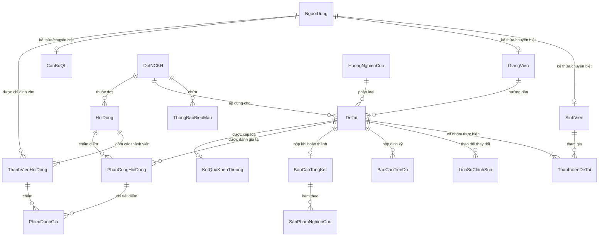

# TÀI LIỆU THIẾT KẾ CƠ SỞ DỮ LIỆU
## HỆ THỐNG QUẢN LÝ HOẠT ĐỘNG NGHIÊN CỨU KHOA HỌC SINH VIÊN

> **Dành cho:** Phân công thành viên phụ trách thiết kế Database (Nguyễn Huy Hoàng)  
> **Căn cứ tài liệu:** `Motabaitoan.md` (Gồm 3 Actor, 15 Use Cases, Quy trình từ Đăng ký, Duyệt, Báo cáo tiến độ đến Nghiệm thu & Khen thưởng)  
> **Chuẩn thiết kế:** Chuẩn hóa 3NF (Third Normal Form), toàn vẹn dữ liệu, hỗ trợ xuất báo cáo & phân quyền chặt chẽ.

---

## 1. TỔNG QUAN VÀ ÁNH XẠ USE CASE VÀO THỰC THỂ

Hệ thống phục vụ 3 nhóm tác nhân chính: **Sinh viên (SV)**, **Giảng viên hướng dẫn (GVHD)**, và **Cán bộ Quản lý NCKH (CBQL)** với 15 Use Cases cốt lõi:

| Nhóm Actor | Use Case (Theo `Motabaitoan.md`) | Bảng Dữ Liệu Liên Quan Trực Tiếp |
| :--- | :--- | :--- |
| **Sinh viên** | 1. Xem thông tin NCKH | `DotNCKH`, `HuongNghienCuu`, `ThongBaoBieuMau` |
| | 2. Đăng ký đề tài | `DeTai`, `ThanhVienDeTai`, `SinhVien`, `GiangVien` |
| | 3. Sửa hồ sơ đề tài | `DeTai`, `LichSuChinhSua` |
| | 4. Nộp báo cáo tiến độ | `BaoCaoTienDo` |
| | 5. Báo cáo tổng kết | `BaoCaoTongKet`, `SanPhamNghienCuu` |
| | 6. Xem kết quả | `KetQuaKhenThuong`, `PhanCongHoiDong` |
| **GVHD** | 7. Tiếp nhận hồ sơ | `DeTai`, `ThanhVienDeTai` |
| | 8. Duyệt hướng dẫn | `DeTai` (Trường trạng thái duyệt, nhận xét) |
| | 9. Theo dõi tiến độ | `BaoCaoTienDo` (Đánh giá, nhận xét tiến độ) |
| | 10. Đánh giá sơ bộ | `BaoCaoTongKet` (Xác nhận cho phép nghiệm thu) |
| **Cán bộ QL** | 11. Quản lý đợt NCKH | `DotNCKH`, `ThongBaoBieuMau`, `HuongNghienCuu` |
| | 12. Thẩm định đề tài | `DeTai` (Trạng thái thẩm định, ý kiến cán bộ) |
| | 13. Quản lý tiến độ | `BaoCaoTienDo`, `DeTai` |
| | 14. Tổ chức nghiệm thu | `HoiDong`, `ThanhVienHoiDong`, `PhanCongHoiDong`, `PhieuDanhGia` |
| | 15. Xếp loại và khen thưởng | `KetQuaKhenThuong` |

---

## 2. SƠ ĐỒ THỰC THỂ LIÊN KẾT (ERD - MERMAID)



---

## 3. TỪ ĐIỂN DỮ LIỆU CHI TIẾT (DATA DICTIONARY)

Hệ thống gồm **14 bảng chuẩn hóa**:

### 3.1. Nhóm Quản trị & Người dùng

#### Bảng 1: `NguoiDung` (Thông tin tài khoản chung)
- **Mục đích:** Lưu trữ thông tin định danh và đăng nhập cho tất cả các tác nhân (Single Sign-On / Authentication).
- **Khóa chính:** `MaNguoiDung`

| Tên Cột | Kiểu Dữ Liệu | Ràng Buộc | Mô Tả |
| :--- | :--- | :--- | :--- |
| `MaNguoiDung` | VARCHAR(20) | PRIMARY KEY | Mã người dùng / Tên đăng nhập (VD: SV001, GV002) |
| `MatKhauHash` | VARCHAR(255) | NOT NULL | Mật khẩu đã mã hóa (BCrypt/Argon2) |
| `HoTen` | VARCHAR(100) | NOT NULL | Họ và tên đầy đủ |
| `Email` | VARCHAR(100) | NOT NULL, UNIQUE | Địa chỉ email nhà trường |
| `SoDienThoai` | VARCHAR(15) | NULL | Số điện thoại liên lạc |
| `VaiTro` | VARCHAR(20) | NOT NULL | Enum: `SINH_VIEN`, `GIANG_VIEN`, `CAN_BO_QL`, `ADMIN` |
| `TrangThai` | VARCHAR(20) | DEFAULT 'HOAT_DONG' | `HOAT_DONG`, `KHOA` |
| `NgayTao` | TIMESTAMP | DEFAULT CURRENT_TIMESTAMP | Thời gian tạo tài khoản |

#### Bảng 2: `SinhVien` (Thông tin chi tiết Sinh viên)
- **Mục đích:** Lưu thông tin đào tạo của sinh viên tham gia NCKH.
- **Khóa chính:** `MaSV` (Khóa ngoại liên kết `NguoiDung(MaNguoiDung)`)

| Tên Cột | Kiểu Dữ Liệu | Ràng Buộc | Mô Tả |
| :--- | :--- | :--- | :--- |
| `MaSV` | VARCHAR(20) | PRIMARY KEY, FK | Mã số sinh viên (trùng `MaNguoiDung`) |
| `Lop` | VARCHAR(50) | NOT NULL | Lớp sinh hoạt (VD: K64 ĐH CNTT) |
| `Khoa` | VARCHAR(100) | NOT NULL | Khoa quản lý (VD: Khoa CNTT) |
| `NganhHoc` | VARCHAR(100) | NOT NULL | Chuyên ngành đào tạo |
| `KhoaHoc` | VARCHAR(20) | NOT NULL | Khóa học (VD: 2023 - 2027) |

#### Bảng 3: `GiangVien` (Thông tin Giảng viên)
- **Mục đích:** Lưu trữ thông tin học hàm, học vị và đơn vị công tác của GVHD/Thành viên hội đồng.
- **Khóa chính:** `MaGV` (Khóa ngoại liên kết `NguoiDung(MaNguoiDung)`)

| Tên Cột | Kiểu Dữ Liệu | Ràng Buộc | Mô Tả |
| :--- | :--- | :--- | :--- |
| `MaGV` | VARCHAR(20) | PRIMARY KEY, FK | Mã giảng viên (trùng `MaNguoiDung`) |
| `HocHam` | VARCHAR(30) | NULL | Giáo sư, Phó Giáo sư,... |
| `HocVi` | VARCHAR(30) | NOT NULL | Thạc sĩ, Tiến sĩ, Cử nhân/Kỹ sư |
| `DonViCongTac` | VARCHAR(100) | NOT NULL | Bộ môn / Khoa giảng dạy |
| `LinhVucNghienCuu` | TEXT | NULL | Các hướng nghiên cứu thế mạnh |

#### Bảng 4: `CanBoQL` (Thông tin Cán bộ Quản lý NCKH)
- **Mục đích:** Lưu thông tin cán bộ phụ trách phòng QLKH & Hợp tác quốc tế.
- **Khóa chính:** `MaCB` (Khóa ngoại liên kết `NguoiDung(MaNguoiDung)`)

| Tên Cột | Kiểu Dữ Liệu | Ràng Buộc | Mô Tả |
| :--- | :--- | :--- | :--- |
| `MaCB` | VARCHAR(20) | PRIMARY KEY, FK | Mã cán bộ quản lý (trùng `MaNguoiDung`) |
| `PhongBan` | VARCHAR(100) | NOT NULL | Tên phòng ban (VD: Phòng QLKH & HTQT) |
| `ChucVu` | VARCHAR(50) | NOT NULL | Chuyên viên, Trưởng phòng, Phó phòng |

---

### 3.2. Nhóm Đợt Phát Động & Hướng Nghiên Cứu

#### Bảng 5: `DotNCKH` (Đợt nghiên cứu khoa học)
- **Mục đích:** Quản lý từng đợt phát động NCKH của nhà trường theo năm học.
- **Khóa chính:** `MaDot`

| Tên Cột | Kiểu Dữ Liệu | Ràng Buộc | Mô Tả |
| :--- | :--- | :--- | :--- |
| `MaDot` | VARCHAR(30) | PRIMARY KEY | Mã đợt (VD: `NCKH_2026_2027_D1`) |
| `TenDot` | VARCHAR(255) | NOT NULL | Tên đợt NCKH sinh viên |
| `NamHoc` | VARCHAR(20) | NOT NULL | Năm học (VD: 2026-2027) |
| `NgayBatDau` | DATE | NOT NULL | Ngày bắt đầu mở đợt |
| `HanDangKy` | DATE | NOT NULL | Hạn chót sinh viên gửi phiếu đăng ký |
| `HanNopBaoCaoTD` | DATE | NOT NULL | Hạn nộp báo cáo tiến độ định kỳ |
| `HanNopNghiemThu`| DATE | NOT NULL | Hạn nộp báo cáo tổng kết & sản phẩm |
| `NgayKetThuc` | DATE | NOT NULL | Ngày kết thúc toàn bộ đợt |
| `TrangThai` | VARCHAR(30) | NOT NULL | `MO_DANG_KY`, `DANG_THUC_HIEN`, `NGHIEM_THU`, `KET_THUC` |
| `MaCanBoTao` | VARCHAR(20) | FK -> `CanBoQL(MaCB)` | Cán bộ quản lý tạo đợt |

#### Bảng 6: `HuongNghienCuu` (Danh mục hướng nghiên cứu)
- **Mục đích:** Lưu trữ các hướng nghiên cứu gợi ý cho sinh viên lựa chọn.
- **Khóa chính:** `MaHuongNC`

| Tên Cột | Kiểu Dữ Liệu | Ràng Buộc | Mô Tả |
| :--- | :--- | :--- | :--- |
| `MaHuongNC` | VARCHAR(30) | PRIMARY KEY | Mã hướng nghiên cứu (VD: `HNC_AI`, `HNC_IOT`) |
| `TenHuongNC` | VARCHAR(255) | NOT NULL | Tên lĩnh vực (VD: Trí tuệ nhân tạo, Hệ thống nhúng) |
| `MoTa` | TEXT | NULL | Mô tả chi tiết và yêu cầu |

#### Bảng 7: `ThongBaoBieuMau` (Thông báo & Biểu mẫu hướng dẫn)
- **Mục đích:** Cán bộ đăng tải quy định, hướng dẫn và các mẫu Phiếu thuyết minh, Phiếu đề xuất.
- **Khóa chính:** `MaThongBao`

| Tên Cột | Kiểu Dữ Liệu | Ràng Buộc | Mô Tả |
| :--- | :--- | :--- | :--- |
| `MaThongBao` | INT | IDENTITY/AUTO_INCREMENT, PK | Khóa tự tăng |
| `MaDot` | VARCHAR(30) | FK -> `DotNCKH(MaDot)` | Thuộc đợt NCKH nào |
| `TieuDe` | VARCHAR(255) | NOT NULL | Tiêu đề bài đăng |
| `Loai` | VARCHAR(30) | NOT NULL | `THONG_BAO`, `BIEU_MAU`, `QUY_DINH` |
| `NoiDung` | TEXT | NULL | Nội dung chi tiết |
| `FileDinhKem` | VARCHAR(500) | NULL | Đường dẫn file biểu mẫu/quy định đính kèm |
| `NgayDang` | TIMESTAMP | DEFAULT CURRENT_TIMESTAMP | Ngày đăng |
| `NguoiDang` | VARCHAR(20) | FK -> `CanBoQL(MaCB)` | Cán bộ đăng tin |

---

### 3.3. Nhóm Hồ Sơ Đề Tài & Nhóm Nghiên Cứu

#### Bảng 8: `DeTai` (Hồ sơ Đề tài NCKH)
- **Mục đích:** Quản lý toàn bộ vòng đời của đề tài nghiên cứu từ lúc đăng ký đến khi nghiệm thu.
- **Khóa chính:** `MaDeTai`

| Tên Cột | Kiểu Dữ Liệu | Ràng Buộc | Mô Tả |
| :--- | :--- | :--- | :--- |
| `MaDeTai` | VARCHAR(30) | PRIMARY KEY | Mã đề tài (VD: `DT_2026_001`) |
| `TenDeTai` | VARCHAR(500) | NOT NULL | Tên đề tài NCKH |
| `MaDot` | VARCHAR(30) | FK -> `DotNCKH(MaDot)` | Thuộc đợt phát động |
| `MaHuongNC` | VARCHAR(30) | FK -> `HuongNghienCuu(MaHuongNC)` | Thuộc hướng nghiên cứu |
| `MaGVHD` | VARCHAR(20) | FK -> `GiangVien(MaGV)` | GVHD được nhóm SV chọn |
| `MucTieu` | TEXT | NOT NULL | Mục tiêu đề tài (Phiếu đề xuất) |
| `NoiDungNC` | TEXT | NOT NULL | Nội dung nghiên cứu chính |
| `SanPhamDuKien` | TEXT | NOT NULL | Sản phẩm dự kiến (Phần mềm, bài báo, mô hình) |
| `KinhPhiDuKien` | DECIMAL(15,2)| DEFAULT 0 | Kinh phí dự trù |
| `FilePhieuThuyetMinh` | VARCHAR(500)| NOT NULL | File đính kèm Phiếu thuyết minh |
| `FilePhieuDeXuat` | VARCHAR(500)| NOT NULL | File đính kèm Phiếu đề xuất |
| `TrangThai` | VARCHAR(40) | NOT NULL | `CHO_GVHD_DUYET`, `GVHD_TU_CHOI`, `CHO_THAM_DINH`, `YEU_CAU_CHINH_SUA`, `DA_PHE_DUYET`, `DANG_THUC_HIEN`, `CHO_NGHIEM_THU`, `DA_NGHIEM_THU`, `HUY` |
| `NhanXetGVHD` | TEXT | NULL | Ý kiến nhận xét/phê duyệt của GVHD |
| `NgayGVHDDuyet` | TIMESTAMP | NULL | Thời điểm GVHD duyệt |
| `NhanXetCanBo` | TEXT | NULL | Ý kiến thẩm định của Cán bộ QL/HĐ trường |
| `NgayCanBoDuyet`| TIMESTAMP | NULL | Thời điểm Cán bộ phê duyệt |
| `NgayDangKy` | TIMESTAMP | DEFAULT CURRENT_TIMESTAMP | Thời điểm nộp đăng ký |

#### Bảng 9: `ThanhVienDeTai` (Nhóm Sinh viên thực hiện đề tài)
- **Mục đích:** Quản lý nhóm sinh viên tham gia đề tài (1 trưởng nhóm + các thành viên).
- **Khóa chính:** Phức hợp (`MaDeTai`, `MaSV`)

| Tên Cột | Kiểu Dữ Liệu | Ràng Buộc | Mô Tả |
| :--- | :--- | :--- | :--- |
| `MaDeTai` | VARCHAR(30) | FK -> `DeTai(MaDeTai)` | Mã đề tài tham gia |
| `MaSV` | VARCHAR(20) | FK -> `SinhVien(MaSV)` | Sinh viên trong nhóm |
| `VaiTro` | VARCHAR(30) | NOT NULL | `TRUONG_NHOM` (Chủ nhiệm), `THANH_VIEN` |
| `NhiemVuCuThe`| VARCHAR(255) | NULL | Phân công công việc trong nhóm |
| `NgayThamGia`| DATE | DEFAULT CURRENT_DATE | Ngày vào nhóm |

#### Bảng 10: `LichSuChinhSua` (Lịch sử sửa đổi hồ sơ đề tài)
- **Mục đích:** Theo dõi Use Case sinh viên chỉnh sửa hồ sơ đề tài theo góp ý của GVHD hoặc Cán bộ thẩm định.
- **Khóa chính:** `MaLichSu`

| Tên Cột | Kiểu Dữ Liệu | Ràng Buộc | Mô Tả |
| :--- | :--- | :--- | :--- |
| `MaLichSu` | INT | IDENTITY/AUTO_INCREMENT, PK | Khóa tự tăng |
| `MaDeTai` | VARCHAR(30) | FK -> `DeTai(MaDeTai)` | Đề tài được chỉnh sửa |
| `LanChinhSua` | INT | NOT NULL | Lần sửa thứ (1, 2, 3,...) |
| `NoiDungSua` | TEXT | NOT NULL | Tóm tắt các nội dung đã sửa theo góp ý |
| `FileThuyetMinhMoi` | VARCHAR(500) | NULL | File thuyết minh cập nhật |
| `FileDeXuatMoi` | VARCHAR(500) | NULL | File đề xuất cập nhật |
| `NgaySua` | TIMESTAMP | DEFAULT CURRENT_TIMESTAMP | Thời điểm nộp bản sửa |
| `NguoiSua` | VARCHAR(20) | FK -> `SinhVien(MaSV)` | Sinh viên thực hiện gửi bản sửa |

---

### 3.4. Nhóm Tiến Độ, Báo Cáo & Sản Phẩm

#### Bảng 11: `BaoCaoTienDo` (Báo cáo tiến độ định kỳ)
- **Mục đích:** Sinh viên nộp báo cáo tiến độ; GVHD và Cán bộ theo dõi, nhận xét.
- **Khóa chính:** `MaBaoCaoTD`

| Tên Cột | Kiểu Dữ Liệu | Ràng Buộc | Mô Tả |
| :--- | :--- | :--- | :--- |
| `MaBaoCaoTD` | INT | IDENTITY/AUTO_INCREMENT, PK | Khóa tự tăng |
| `MaDeTai` | VARCHAR(30) | FK -> `DeTai(MaDeTai)` | Đề tài nộp báo cáo |
| `DotBaoCao` | VARCHAR(50) | NOT NULL | Tên đợt báo cáo (VD: Báo cáo giữa kỳ, Đợt 1) |
| `PhanTramHoanThanh`| INT | CHECK (0 <= PhanTramHoanThanh <= 100) | Tiến độ ước lượng (%) |
| `CongViecDaLam` | TEXT | NOT NULL | Mô tả khối lượng việc đã hoàn thành |
| `KhoKhanVuongMac` | TEXT | NULL | Khó khăn cần hỗ trợ |
| `FileBaoCao` | VARCHAR(500) | NOT NULL | Đường dẫn file báo cáo tiến độ |
| `NgayNop` | TIMESTAMP | DEFAULT CURRENT_TIMESTAMP | Thời điểm nộp báo cáo |
| `NhanXetGVHD` | TEXT | NULL | Đánh giá nhận xét của GVHD |
| `DanhGiaTienDo` | VARCHAR(30) | NULL | `DAT_TIEN_DO`, `CHAM_TIEN_DO`, `CAN_NHAC_NHO` |
| `NgayDanhGia` | TIMESTAMP | NULL | Ngày GVHD nhận xét |

#### Bảng 12: `BaoCaoTongKet` (Báo cáo tổng kết & Đánh giá sơ bộ)
- **Mục đích:** Nộp khi đến hạn nghiệm thu; GVHD đánh giá sơ bộ và cho phép nghiệm thu.
- **Khóa chính:** `MaBaoCaoTK` (1 Đề tài có 1 Báo cáo tổng kết duy nhất)

| Tên Cột | Kiểu Dữ Liệu | Ràng Buộc | Mô Tả |
| :--- | :--- | :--- | :--- |
| `MaBaoCaoTK` | INT | IDENTITY/AUTO_INCREMENT, PK | Khóa tự tăng |
| `MaDeTai` | VARCHAR(30) | NOT NULL, UNIQUE, FK -> `DeTai` | Đề tài nghiệm thu |
| `TomTatKetQua` | TEXT | NOT NULL | Tóm tắt kết quả nghiên cứu đạt được |
| `FileBaoCaoTongKet`| VARCHAR(500)| NOT NULL | File toàn văn Báo cáo tổng kết |
| `NgayNop` | TIMESTAMP | DEFAULT CURRENT_TIMESTAMP | Ngày sinh viên nộp |
| `DanhGiaSoBoGVHD` | VARCHAR(30) | NOT NULL DEFAULT 'CHO_DANH_GIA' | `CHO_DANH_GIA`, `DONG_Y_NGHIEM_THU`, `KHONG_DONG_Y` |
| `NhanXetSoBoGVHD` | TEXT | NULL | Ý kiến nhận xét sơ bộ của GVHD |
| `NgayGVHDDanhGia` | TIMESTAMP | NULL | Ngày GVHD xác nhận cho nghiệm thu |

#### Bảng 13: `SanPhamNghienCuu` (Sản phẩm đề tài nghiên cứu)
- **Mục đích:** Quản lý chi tiết các sản phẩm sinh viên nộp (phần mềm, bài báo, mô hình...).
- **Khóa chính:** `MaSanPham`

| Tên Cột | Kiểu Dữ Liệu | Ràng Buộc | Mô Tả |
| :--- | :--- | :--- | :--- |
| `MaSanPham` | INT | IDENTITY/AUTO_INCREMENT, PK | Khóa tự tăng |
| `MaBaoCaoTK` | INT | FK -> `BaoCaoTongKet(MaBaoCaoTK)` | Thuộc báo cáo tổng kết nào |
| `TenSanPham` | VARCHAR(255) | NOT NULL | Tên sản phẩm |
| `LoaiSanPham` | VARCHAR(50) | NOT NULL | `PHAN_MEM`, `BAI_BAO_KHOA_HOC`, `MO_HINH`, `QUY_TRINH` |
| `MoTaSanPham` | TEXT | NULL | Giới thiệu chức năng, thông số sản phẩm |
| `LienKetMinhChung` | VARCHAR(500) | NULL | Link GitHub, link demo hoặc URL bài báo |
| `FileMinhChung` | VARCHAR(500) | NULL | File minh chứng (PDF/ZIP) |

---

### 3.5. Nhóm Hội Đồng Nghiệm Thu, Đánh Giá & Khen Thưởng

#### Bảng 14: `HoiDong` (Hội đồng đánh giá nghiệm thu)
- **Mục đích:** Cán bộ QL thành lập hội đồng để thẩm định hoặc nghiệm thu đề tài.
- **Khóa chính:** `MaHoiDong`

| Tên Cột | Kiểu Dữ Liệu | Ràng Buộc | Mô Tả |
| :--- | :--- | :--- | :--- |
| `MaHoiDong` | VARCHAR(30) | PRIMARY KEY | Mã hội đồng (VD: `HD_NT_2026_01`) |
| `TenHoiDong` | VARCHAR(255) | NOT NULL | Tên hội đồng nghiệm thu |
| `MaDot` | VARCHAR(30) | FK -> `DotNCKH(MaDot)` | Thuộc đợt NCKH nào |
| `LoaiHoiDong`| VARCHAR(30) | NOT NULL | `THAM_DINH`, `NGHIEM_THU` |
| `NgayThanhLap`| DATE | NOT NULL | Ngày có quyết định thành lập |
| `SoQuyetDinh` | VARCHAR(100) | NULL | Số hiệu văn bản quyết định |
| `TrangThai` | VARCHAR(30) | DEFAULT 'HOAT_DONG' | `HOAT_DONG`, `HOAN_THANH` |

#### Bảng 15: `ThanhVienHoiDong` (Thành viên tham gia hội đồng)
- **Mục đích:** Danh sách các cán bộ, giảng viên, chuyên gia tham gia hội đồng với các vị trí cụ thể.
- **Khóa chính:** Phức hợp (`MaHoiDong`, `MaNguoiDung`)

| Tên Cột | Kiểu Dữ Liệu | Ràng Buộc | Mô Tả |
| :--- | :--- | :--- | :--- |
| `MaHoiDong` | VARCHAR(30) | FK -> `HoiDong(MaHoiDong)` | Hội đồng tham gia |
| `MaNguoiDung`| VARCHAR(20) | FK -> `NguoiDung(MaNguoiDung)`| Thành viên (Giảng viên/Chuyên gia) |
| `VaiTroHoiDong`| VARCHAR(30) | NOT NULL | `CHU_TICH`, `THU_KY`, `PHAN_BIEN_1`, `PHAN_BIEN_2`, `UY_VIEN` |

#### Bảng 16: `PhanCongHoiDong` (Đề tài được phân công vào Hội đồng)
- **Mục đích:** Quản lý lịch bảo vệ và tổng hợp kết quả nghiệm thu của từng đề tài tại hội đồng.
- **Khóa chính:** `MaPhanCong`

| Tên Cột | Kiểu Dữ Liệu | Ràng Buộc | Mô Tả |
| :--- | :--- | :--- | :--- |
| `MaPhanCong` | INT | IDENTITY/AUTO_INCREMENT, PK | Khóa tự tăng |
| `MaHoiDong` | VARCHAR(30) | FK -> `HoiDong(MaHoiDong)` | Hội đồng phụ trách |
| `MaDeTai` | VARCHAR(30) | NOT NULL, UNIQUE, FK -> `DeTai`| Đề tài được nghiệm thu |
| `ThoiGianBaoCao` | TIMESTAMP | NOT NULL | Ngày giờ tổ chức nghiệm thu đề tài |
| `DiaDiem` | VARCHAR(255) | NOT NULL | Phòng họp / Hội trường bảo vệ |
| `DiemTrungBinh`| DECIMAL(4,2) | NULL | Điểm tổng kết trung bình của hội đồng |
| `KetLuan` | VARCHAR(30) | NULL | `DAT`, `KHONG_DAT`, `BAO_VE_LAI` |
| `FileBienBan` | VARCHAR(500) | NULL | File scan Biên bản họp hội đồng |

#### Bảng 17: `PhieuDanhGia` (Phiếu chấm điểm chi tiết của từng giám khảo)
- **Mục đích:** Lưu trữ điểm và nhận xét của từng thành viên hội đồng cho đề tài.
- **Khóa chính:** `MaPhieu`

| Tên Cột | Kiểu Dữ Liệu | Ràng Buộc | Mô Tả |
| :--- | :--- | :--- | :--- |
| `MaPhieu` | INT | IDENTITY/AUTO_INCREMENT, PK | Khóa tự tăng |
| `MaPhanCong` | INT | FK -> `PhanCongHoiDong(MaPhanCong)` | Thuộc phiên nghiệm thu đề tài nào |
| `MaGiamKhao` | VARCHAR(20) | FK -> `NguoiDung(MaNguoiDung)`| Giám khảo chấm điểm |
| `DiemTongQuan` | DECIMAL(4,2) | CHECK (0 <= DiemTongQuan <= 20) | Điểm tổng quan tình hình nghiên cứu (max 20) |
| `DiemPhuongPhap`| DECIMAL(4,2) | CHECK (0 <= DiemPhuongPhap <= 30) | Phương pháp và nội dung nghiên cứu (max 30) |
| `DiemSanPham` | DECIMAL(4,2) | CHECK (0 <= DiemSanPham <= 30) | Giá trị khoa học & ứng dụng sản phẩm (max 30)|
| `DiemBaoCao` | DECIMAL(4,2) | CHECK (0 <= DiemBaoCao <= 20) | Trình bày và trả lời câu hỏi (max 20) |
| `TongDiem` | DECIMAL(4,2) | GENERATED ALWAYS AS (tổng 4 cột trên) | Tổng điểm (thang 100) |
| `NhanXetChiTiet`| TEXT | NULL | Đánh giá ưu/nhược điểm và hướng phát triển |
| `NgayCham` | TIMESTAMP | DEFAULT CURRENT_TIMESTAMP | Thời điểm chấm |

#### Bảng 18: `KetQuaKhenThuong` (Xếp loại và Khen thưởng)
- **Mục đích:** Lưu trữ xếp loại chung cuộc và các danh hiệu khen thưởng, phục vụ xuất thống kê báo cáo.
- **Khóa chính:** `MaKetQua`

| Tên Cột | Kiểu Dữ Liệu | Ràng Buộc | Mô Tả |
| :--- | :--- | :--- | :--- |
| `MaKetQua` | INT | IDENTITY/AUTO_INCREMENT, PK | Khóa tự tăng |
| `MaDeTai` | VARCHAR(30) | NOT NULL, UNIQUE, FK -> `DeTai`| Đề tài được xếp loại |
| `DiemTongKet` | DECIMAL(4,2) | NOT NULL | Điểm chính thức sau nghiệm thu |
| `XepLoai` | VARCHAR(30) | NOT NULL | `XUAT_SAC`, `TOT`, `KHA`, `DAT`, `KHONG_DAT` |
| `DanhHieuKhenThuong`| VARCHAR(50)| NULL | `GIAI_NHAT`, `GIAI_NHI`, `GIAI_BA`, `GIAI_KHUYEN_KHICH`, `KHONG` |
| `SoQuyetDinh` | VARCHAR(100) | NULL | Quyết định khen thưởng của Hiệu trưởng |
| `TienThuong` | DECIMAL(15,2)| DEFAULT 0 | Mức tiền thưởng (VNĐ) |
| `GhiChu` | TEXT | NULL | Ghi chú thêm |
| `NgayQuyetDinh` | DATE | NULL | Ngày ban hành quyết định |

---

## 4. MA TRẬN MỐI QUAN HỆ & BẢN SỐ (CARDINALITY MATRIX)

| Bảng Gốc (Parent) | Bảng Tham Chiếu (Child) | Mối Quan Hệ | Bản Số (Cardinality) | Ý Nghĩa Nghiệp Vụ |
| :--- | :--- | :---: | :---: | :--- |
| `DotNCKH` | `DeTai` | 1 - N | 1 : 0..* | Một đợt có nhiều đề tài đăng ký; Một đề tài chỉ thuộc 1 đợt |
| `HuongNghienCuu` | `DeTai` | 1 - N | 1 : 0..* | Một hướng nghiên cứu có nhiều đề tài lựa chọn |
| `GiangVien` | `DeTai` | 1 - N | 1 : 0..* | Một GVHD có thể hướng dẫn nhiều đề tài; Đề tài chỉ có 1 GVHD chính |
| `DeTai` | `ThanhVienDeTai` | 1 - N | 1 : 1..5 | Một đề tài có tối thiểu 1 SV (Trưởng nhóm), tối đa 5 SV |
| `SinhVien` | `ThanhVienDeTai` | 1 - N | 1 : 0..* | Một sinh viên có thể tham gia vào đề tài (thường tối đa 1 đề tài/đợt) |
| `DeTai` | `LichSuChinhSua` | 1 - N | 1 : 0..* | Một đề tài có thể có nhiều lần chỉnh sửa hồ sơ theo góp ý |
| `DeTai` | `BaoCaoTienDo` | 1 - N | 1 : 0..* | Định kỳ sinh viên nộp nhiều lần báo cáo tiến độ |
| `DeTai` | `BaoCaoTongKet` | 1 - 1 | 1 : 0..1 | Một đề tài khi nghiệm thu có duy nhất 1 báo cáo tổng kết |
| `BaoCaoTongKet` | `SanPhamNghienCuu`| 1 - N | 1 : 1..* | Một báo cáo tổng kết có ít nhất 1 hoặc nhiều sản phẩm kèm theo |
| `DotNCKH` | `HoiDong` | 1 - N | 1 : 0..* | Một đợt NCKH có thể thành lập nhiều hội đồng theo chuyên ngành |
| `HoiDong` | `ThanhVienHoiDong`| 1 - N | 1 : 3..5 | Một hội đồng có từ 3 đến 5 thành viên (Chủ tịch, Thư ký, Phản biện...) |
| `HoiDong` | `PhanCongHoiDong` | 1 - N | 1 : 0..* | Một hội đồng có thể chấm cho nhiều đề tài |
| `DeTai` | `PhanCongHoiDong` | 1 - 1 | 1 : 0..1 | Một đề tài chỉ được xếp vào 1 hội đồng nghiệm thu chính thức |
| `PhanCongHoiDong` | `PhieuDanhGia` | 1 - N | 1 : 3..5 | Mỗi giám khảo trong hội đồng cho 1 phiếu điểm chi tiết |
| `DeTai` | `KetQuaKhenThuong`| 1 - 1 | 1 : 0..1 | Mỗi đề tài hoàn thành có 1 kết quả xếp loại và khen thưởng |

---

## 5. RÀNG BUỘC TOÀN VẸN & QUY TẮC NGHIỆP VỤ (BUSINESS RULES)

1. **Ràng buộc Trưởng nhóm (Leader Constraint):**
   - Trong bảng `ThanhVienDeTai`, với mỗi `MaDeTai`, **bắt buộc phải có đúng 1 dòng** có `VaiTro = 'TRUONG_NHOM'`.
2. **Ràng buộc Hội đồng khách quan (Conflict of Interest Prevention):**
   - Thành viên trong hội đồng nghiệm thu của một đề tài (`ThanhVienHoiDong`) **không được trùng với GVHD** của chính đề tài đó (`DeTai.MaGVHD`).
3. **Quy trình duyệt hồ sơ (Workflow State Transition):**
   - Khi tạo mới: `CHO_GVHD_DUYET`.
   - GVHD đồng ý -> `CHO_THAM_DINH`; GVHD từ chối -> `GVHD_TU_CHOI`.
   - Cán bộ thẩm định nếu yêu cầu sửa -> `YEU_CAU_CHINH_SUA` (cho phép SV sửa qua bảng `LichSuChinhSua` rồi chuyển lại `CHO_THAM_DINH`).
   - Cán bộ phê duyệt -> `DA_PHE_DUYET` -> `DANG_THUC_HIEN`.
   - Khi nộp báo cáo tổng kết & GVHD cho phép nghiệm thu -> `CHO_NGHIEM_THU`.
   - Hội đồng họp và chấm điểm -> `DA_NGHIEM_THU`.
4. **Ràng buộc tiến độ & Báo cáo tổng kết:**
   - Đề tài chỉ được phép nộp `BaoCaoTongKet` khi trạng thái đang là `DANG_THUC_HIEN`.
   - Chỉ khi `BaoCaoTongKet.DanhGiaSoBoGVHD = 'DONG_Y_NGHIEM_THU'` thì Cán bộ quản lý mới có thể gán đề tài vào `PhanCongHoiDong`.
5. **Ràng buộc xếp loại khen thưởng:**
   - Xếp loại `XUAT_SAC`: Điểm >= 9.0 và có bài báo hoặc sản phẩm ứng dụng thực tế.
   - Xếp loại `TOT`: Điểm từ 8.0 đến < 9.0.
   - Xếp loại `KHA`: Điểm từ 7.0 đến < 8.0.
   - Xếp loại `DAT`: Điểm từ 5.0 đến < 7.0.
   - Xếp loại `KHONG_DAT`: Điểm < 5.0.

---

## 6. SCRIPT SQL DDL THIẾT KẾ CSDL (POSTGRESQL / MYSQL COMPLIANT)

Dưới đây là mã nguồn SQL DDL hoàn chỉnh có sẵn để bạn Hoàng có thể chạy thử nghiệm trực tiếp trên DBMS hoặc import vào công cụ thiết kế:

```sql
-- ============================================================================
-- SCRIPT TẠO CƠ SỞ DỮ LIỆU: QUẢN LÝ NCKH SINH VIÊN
-- ============================================================================

-- 1. BẢNG NGUOIDUNG & PHÂN HỆ NGƯỜI DÙNG
CREATE TABLE NguoiDung (
    MaNguoiDung VARCHAR(20) PRIMARY KEY,
    MatKhauHash VARCHAR(255) NOT NULL,
    HoTen VARCHAR(100) NOT NULL,
    Email VARCHAR(100) NOT NULL UNIQUE,
    SoDienThoai VARCHAR(15),
    VaiTro VARCHAR(20) NOT NULL CHECK (VaiTro IN ('SINH_VIEN', 'GIANG_VIEN', 'CAN_BO_QL', 'ADMIN')),
    TrangThai VARCHAR(20) DEFAULT 'HOAT_DONG' CHECK (TrangThai IN ('HOAT_DONG', 'KHOA')),
    NgayTao TIMESTAMP DEFAULT CURRENT_TIMESTAMP
);

CREATE TABLE SinhVien (
    MaSV VARCHAR(20) PRIMARY KEY REFERENCES NguoiDung(MaNguoiDung) ON DELETE CASCADE,
    Lop VARCHAR(50) NOT NULL,
    Khoa VARCHAR(100) NOT NULL,
    NganhHoc VARCHAR(100) NOT NULL,
    KhoaHoc VARCHAR(20) NOT NULL
);

CREATE TABLE GiangVien (
    MaGV VARCHAR(20) PRIMARY KEY REFERENCES NguoiDung(MaNguoiDung) ON DELETE CASCADE,
    HocHam VARCHAR(30),
    HocVi VARCHAR(30) NOT NULL,
    DonViCongTac VARCHAR(100) NOT NULL,
    LinhVucNghienCuu TEXT
);

CREATE TABLE CanBoQL (
    MaCB VARCHAR(20) PRIMARY KEY REFERENCES NguoiDung(MaNguoiDung) ON DELETE CASCADE,
    PhongBan VARCHAR(100) NOT NULL,
    ChucVu VARCHAR(50) NOT NULL
);

-- 2. ĐỢT NCKH & HƯỚNG NGHIÊN CỨU
CREATE TABLE DotNCKH (
    MaDot VARCHAR(30) PRIMARY KEY,
    TenDot VARCHAR(255) NOT NULL,
    NamHoc VARCHAR(20) NOT NULL,
    NgayBatDau DATE NOT NULL,
    HanDangKy DATE NOT NULL,
    HanNopBaoCaoTD DATE NOT NULL,
    HanNopNghiemThu DATE NOT NULL,
    NgayKetThuc DATE NOT NULL,
    TrangThai VARCHAR(30) DEFAULT 'MO_DANG_KY' CHECK (TrangThai IN ('MO_DANG_KY', 'DANG_THUC_HIEN', 'NGHIEM_THU', 'KET_THUC')),
    MaCanBoTao VARCHAR(20) REFERENCES CanBoQL(MaCB)
);

CREATE TABLE HuongNghienCuu (
    MaHuongNC VARCHAR(30) PRIMARY KEY,
    TenHuongNC VARCHAR(255) NOT NULL,
    MoTa TEXT
);

CREATE TABLE ThongBaoBieuMau (
    MaThongBao SERIAL PRIMARY KEY,
    MaDot VARCHAR(30) REFERENCES DotNCKH(MaDot) ON DELETE CASCADE,
    TieuDe VARCHAR(255) NOT NULL,
    Loai VARCHAR(30) NOT NULL CHECK (Loai IN ('THONG_BAO', 'BIEU_MAU', 'QUY_DINH')),
    NoiDung TEXT,
    FileDinhKem VARCHAR(500),
    NgayDang TIMESTAMP DEFAULT CURRENT_TIMESTAMP,
    NguoiDang VARCHAR(20) REFERENCES CanBoQL(MaCB)
);

-- 3. HỒ SƠ ĐỀ TÀI & NHÓM THỰC HIỆN
CREATE TABLE DeTai (
    MaDeTai VARCHAR(30) PRIMARY KEY,
    TenDeTai VARCHAR(500) NOT NULL,
    MaDot VARCHAR(30) NOT NULL REFERENCES DotNCKH(MaDot),
    MaHuongNC VARCHAR(30) NOT NULL REFERENCES HuongNghienCuu(MaHuongNC),
    MaGVHD VARCHAR(20) NOT NULL REFERENCES GiangVien(MaGV),
    MucTieu TEXT NOT NULL,
    NoiDungNC TEXT NOT NULL,
    SanPhamDuKien TEXT NOT NULL,
    KinhPhiDuKien DECIMAL(15,2) DEFAULT 0,
    FilePhieuThuyetMinh VARCHAR(500) NOT NULL,
    FilePhieuDeXuat VARCHAR(500) NOT NULL,
    TrangThai VARCHAR(40) NOT NULL DEFAULT 'CHO_GVHD_DUYET' CHECK (TrangThai IN (
        'CHO_GVHD_DUYET', 'GVHD_TU_CHOI', 'CHO_THAM_DINH', 'YEU_CAU_CHINH_SUA', 
        'DA_PHE_DUYET', 'DANG_THUC_HIEN', 'CHO_NGHIEM_THU', 'DA_NGHIEM_THU', 'HUY'
    )),
    NhanXetGVHD TEXT,
    NgayGVHDDuyet TIMESTAMP,
    NhanXetCanBo TEXT,
    NgayCanBoDuyet TIMESTAMP,
    NgayDangKy TIMESTAMP DEFAULT CURRENT_TIMESTAMP
);

CREATE TABLE ThanhVienDeTai (
    MaDeTai VARCHAR(30) REFERENCES DeTai(MaDeTai) ON DELETE CASCADE,
    MaSV VARCHAR(20) REFERENCES SinhVien(MaSV) ON DELETE CASCADE,
    VaiTro VARCHAR(30) NOT NULL CHECK (VaiTro IN ('TRUONG_NHOM', 'THANH_VIEN')),
    NhiemVuCuThe VARCHAR(255),
    NgayThamGia DATE DEFAULT CURRENT_DATE,
    PRIMARY KEY (MaDeTai, MaSV)
);

CREATE TABLE LichSuChinhSua (
    MaLichSu SERIAL PRIMARY KEY,
    MaDeTai VARCHAR(30) NOT NULL REFERENCES DeTai(MaDeTai) ON DELETE CASCADE,
    LanChinhSua INT NOT NULL,
    NoiDungSua TEXT NOT NULL,
    FileThuyetMinhMoi VARCHAR(500),
    FileDeXuatMoi VARCHAR(500),
    NgaySua TIMESTAMP DEFAULT CURRENT_TIMESTAMP,
    NguoiSua VARCHAR(20) REFERENCES SinhVien(MaSV)
);

-- 4. BÁO CÁO TIẾN ĐỘ, TỔNG KẾT & SẢN PHẨM
CREATE TABLE BaoCaoTienDo (
    MaBaoCaoTD SERIAL PRIMARY KEY,
    MaDeTai VARCHAR(30) NOT NULL REFERENCES DeTai(MaDeTai) ON DELETE CASCADE,
    DotBaoCao VARCHAR(50) NOT NULL,
    PhanTramHoanThanh INT CHECK (PhanTramHoanThanh BETWEEN 0 AND 100),
    CongViecDaLam TEXT NOT NULL,
    KhoKhanVuongMac TEXT,
    FileBaoCao VARCHAR(500) NOT NULL,
    NgayNop TIMESTAMP DEFAULT CURRENT_TIMESTAMP,
    NhanXetGVHD TEXT,
    DanhGiaTienDo VARCHAR(30) CHECK (DanhGiaTienDo IN ('DAT_TIEN_DO', 'CHAM_TIEN_DO', 'CAN_NHAC_NHO')),
    NgayDanhGia TIMESTAMP
);

CREATE TABLE BaoCaoTongKet (
    MaBaoCaoTK SERIAL PRIMARY KEY,
    MaDeTai VARCHAR(30) NOT NULL UNIQUE REFERENCES DeTai(MaDeTai) ON DELETE CASCADE,
    TomTatKetQua TEXT NOT NULL,
    FileBaoCaoTongKet VARCHAR(500) NOT NULL,
    NgayNop TIMESTAMP DEFAULT CURRENT_TIMESTAMP,
    DanhGiaSoBoGVHD VARCHAR(30) DEFAULT 'CHO_DANH_GIA' CHECK (DanhGiaSoBoGVHD IN ('CHO_DANH_GIA', 'DONG_Y_NGHIEM_THU', 'KHONG_DONG_Y')),
    NhanXetSoBoGVHD TEXT,
    NgayGVHDDanhGia TIMESTAMP
);

CREATE TABLE SanPhamNghienCuu (
    MaSanPham SERIAL PRIMARY KEY,
    MaBaoCaoTK INT NOT NULL REFERENCES BaoCaoTongKet(MaBaoCaoTK) ON DELETE CASCADE,
    TenSanPham VARCHAR(255) NOT NULL,
    LoaiSanPham VARCHAR(50) NOT NULL CHECK (LoaiSanPham IN ('PHAN_MEM', 'BAI_BAO_KHOA_HOC', 'MO_HINH', 'QUY_TRINH')),
    MoTaSanPham TEXT,
    LienKetMinhChung VARCHAR(500),
    FileMinhChung VARCHAR(500)
);

-- 5. HỘI ĐỒNG NGHIỆM THU, CHẤM ĐIỂM & KHEN THƯỞNG
CREATE TABLE HoiDong (
    MaHoiDong VARCHAR(30) PRIMARY KEY,
    TenHoiDong VARCHAR(255) NOT NULL,
    MaDot VARCHAR(30) NOT NULL REFERENCES DotNCKH(MaDot),
    LoaiHoiDong VARCHAR(30) NOT NULL CHECK (LoaiHoiDong IN ('THAM_DINH', 'NGHIEM_THU')),
    NgayThanhLap DATE NOT NULL,
    SoQuyetDinh VARCHAR(100),
    TrangThai VARCHAR(30) DEFAULT 'HOAT_DONG' CHECK (TrangThai IN ('HOAT_DONG', 'HOAN_THANH'))
);

CREATE TABLE ThanhVienHoiDong (
    MaHoiDong VARCHAR(30) REFERENCES HoiDong(MaHoiDong) ON DELETE CASCADE,
    MaNguoiDung VARCHAR(20) REFERENCES NguoiDung(MaNguoiDung) ON DELETE CASCADE,
    VaiTroHoiDong VARCHAR(30) NOT NULL CHECK (VaiTroHoiDong IN ('CHU_TICH', 'THU_KY', 'PHAN_BIEN_1', 'PHAN_BIEN_2', 'UY_VIEN')),
    PRIMARY KEY (MaHoiDong, MaNguoiDung)
);

CREATE TABLE PhanCongHoiDong (
    MaPhanCong SERIAL PRIMARY KEY,
    MaHoiDong VARCHAR(30) NOT NULL REFERENCES HoiDong(MaHoiDong),
    MaDeTai VARCHAR(30) NOT NULL UNIQUE REFERENCES DeTai(MaDeTai),
    ThoiGianBaoCao TIMESTAMP NOT NULL,
    DiaDiem VARCHAR(255) NOT NULL,
    DiemTrungBinh DECIMAL(4,2),
    KetLuan VARCHAR(30) CHECK (KetLuan IN ('DAT', 'KHONG_DAT', 'BAO_VE_LAI')),
    FileBienBan VARCHAR(500)
);

CREATE TABLE PhieuDanhGia (
    MaPhieu SERIAL PRIMARY KEY,
    MaPhanCong INT NOT NULL REFERENCES PhanCongHoiDong(MaPhanCong) ON DELETE CASCADE,
    MaGiamKhao VARCHAR(20) NOT NULL REFERENCES NguoiDung(MaNguoiDung),
    DiemTongQuan DECIMAL(4,2) CHECK (DiemTongQuan BETWEEN 0 AND 20),
    DiemPhuongPhap DECIMAL(4,2) CHECK (DiemPhuongPhap BETWEEN 0 AND 30),
    DiemSanPham DECIMAL(4,2) CHECK (DiemSanPham BETWEEN 0 AND 30),
    DiemBaoCao DECIMAL(4,2) CHECK (DiemBaoCao BETWEEN 0 AND 20),
    TongDiem DECIMAL(4,2) GENERATED ALWAYS AS (DiemTongQuan + DiemPhuongPhap + DiemSanPham + DiemBaoCao) STORED,
    NhanXetChiTiet TEXT,
    NgayCham TIMESTAMP DEFAULT CURRENT_TIMESTAMP
);

CREATE TABLE KetQuaKhenThuong (
    MaKetQua SERIAL PRIMARY KEY,
    MaDeTai VARCHAR(30) NOT NULL UNIQUE REFERENCES DeTai(MaDeTai) ON DELETE CASCADE,
    DiemTongKet DECIMAL(4,2) NOT NULL,
    XepLoai VARCHAR(30) NOT NULL CHECK (XepLoai IN ('XUAT_SAC', 'TOT', 'KHA', 'DAT', 'KHONG_DAT')),
    DanhHieuKhenThuong VARCHAR(50) DEFAULT 'KHONG' CHECK (DanhHieuKhenThuong IN ('GIAI_NHAT', 'GIAI_NHI', 'GIAI_BA', 'GIAI_KHUYEN_KHICH', 'KHONG')),
    SoQuyetDinh VARCHAR(100),
    TienThuong DECIMAL(15,2) DEFAULT 0,
    GhiChu TEXT,
    NgayQuyetDinh DATE
);

-- ============================================================================
-- CÁC CHỈ MỤC (INDEXES) ĐỂ TỐI ƯU TRUY VẤN
-- ============================================================================
CREATE INDEX idx_detai_madot ON DeTai(MaDot);
CREATE INDEX idx_detai_trangthai ON DeTai(TrangThai);
CREATE INDEX idx_detai_magvhd ON DeTai(MaGVHD);
CREATE INDEX idx_thanhvien_masv ON ThanhVienDeTai(MaSV);
CREATE INDEX idx_baocaotd_madetai ON BaoCaoTienDo(MaDeTai);
CREATE INDEX idx_phancong_mahd ON PhanCongHoiDong(MaHoiDong);
